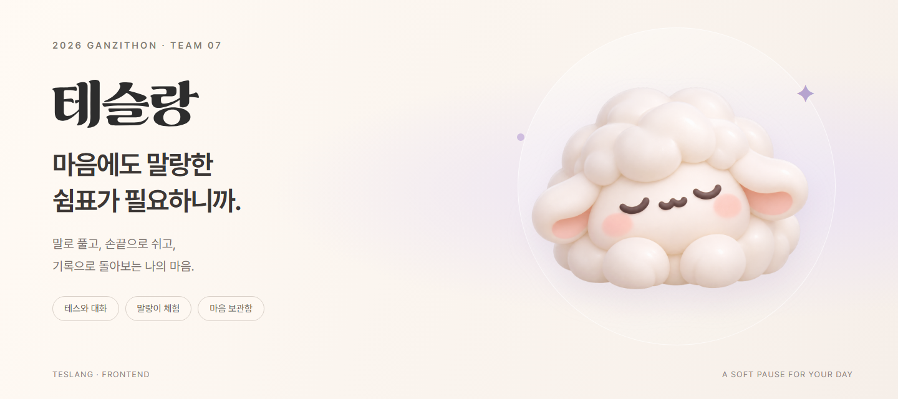
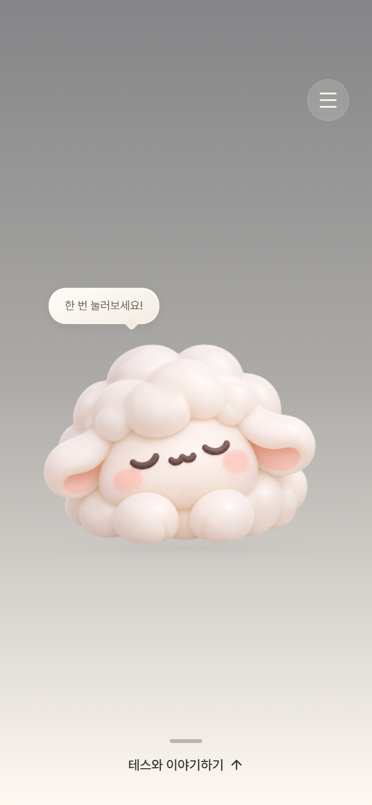
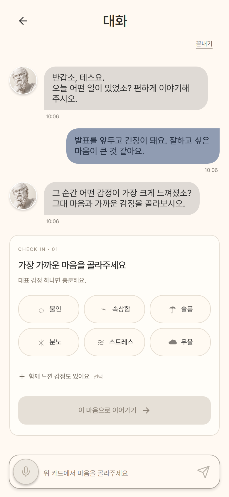
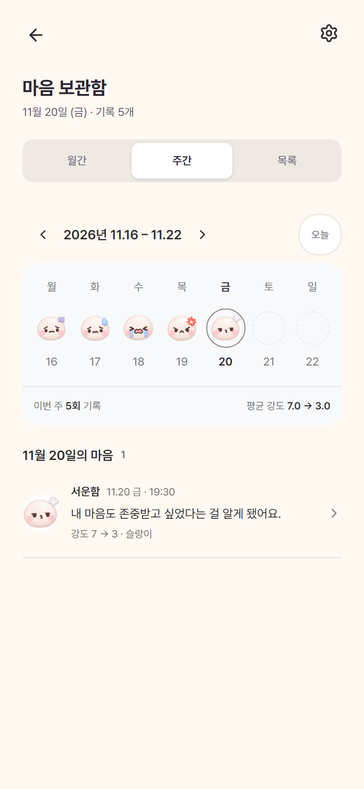
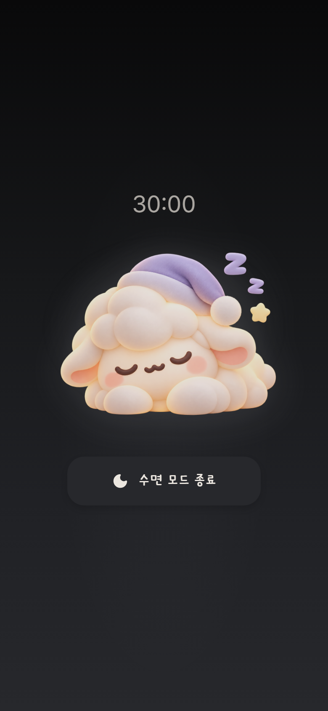

<p align="center">
  
</p>

<h1 align="center">테슬랑 · TESLANG</h1>

<p align="center">
  <strong>말로 풀고, 손끝으로 쉬고,<br />기록으로 돌아보는 나의 마음.</strong><br />
  2026 GANZITHON · TEAM 07 · Frontend
</p>

<p align="center">
  <a href="https://teslang-xi.vercel.app"><strong>서비스 바로가기 ↗</strong></a>
  &nbsp; · &nbsp;
  <a href="#화면으로-만나는-테슬랑">대표 화면</a>
  &nbsp; · &nbsp;
  <a href="#로컬에서-실행하기">실행 방법</a>
</p>

---

## 혼자 정리하기 어려운 마음에, 작은 시작점

발표를 앞두고 긴장되거나, 관계에서 서운한 일이 생겼을 때. 감정은 분명하지만 어디서부터 이야기해야 할지 막막할 수 있습니다. **테슬랑**은 이런 일상의 감정을 혼자 정리하기 어려운 학생·취업 준비생·직장인을 위한 모바일 웹서비스입니다.

철학자 캐릭터 **‘테스’와의 대화 → 손끝으로 만지는 말랑이 → 다시 돌아볼 수 있는 기록**을 연결합니다. 이야기를 꺼내는 것부터 잠깐 쉬어가는 것까지, 사용자가 자신의 속도로 선택할 수 있도록 설계했습니다.

| 사용자가 겪는 순간 | 테슬랑의 접근 |
| --- | --- |
| 무슨 감정인지, 어떻게 설명할지 막막할 때 | 상황을 이야기하고 감정과 강도를 직접 선택하는 대화 |
| 긴 이야기를 이어가기보다 잠깐 쉬고 싶을 때 | 별도 도구 없이 화면에서 누르고 늘리고 깨뜨리는 말랑이 체험 |
| 지난 마음을 다시 돌아보고 싶을 때 | 대화 요약·작은 실천·전후 감정 강도를 함께 보관하는 기록 |

> **테스와 이야기하기 → 감정과 마음의 강도 살펴보기 → 이야기 정리·말랑이 추천 → 말랑이 체험·마음 보관함**

별도의 앱 설치 없이 [배포 주소](https://teslang-xi.vercel.app)에서 이메일로 가입하고 시작할 수 있습니다. 한 번의 대화 이후에도 기록을 돌아보거나 말랑이·수면모드를 이용하며 일상 속 쉼의 도구로 다시 찾을 수 있습니다.

## 화면으로 만나는 테슬랑

<table>
  <tr>
    <th align="center" width="50%">01 · 말랑이와 쉼</th>
    <th align="center" width="50%">02 · 테스와 대화</th>
  </tr>
  <tr>
    <td align="center"></td>
    <td align="center"></td>
  </tr>
  <tr>
    <td align="center">말랑이를 만지고<br />이야기를 시작해요.</td>
    <td align="center">감정을 살펴보며<br />마음을 정리해요.</td>
  </tr>
  <tr>
    <th align="center">03 · 마음 보관함</th>
    <th align="center">04 · 수면모드</th>
  </tr>
  <tr>
    <td align="center"></td>
    <td align="center"></td>
  </tr>
  <tr>
    <td align="center">날짜별 기록으로<br />마음을 돌아봐요.</td>
    <td align="center">소리와 타이머로<br />하루를 마무리해요.</td>
  </tr>
</table>

<sub>현재 프론트엔드에서 직접 촬영한 화면입니다. 대화와 감정 기록은 개인정보가 없는 소개용 예시 데이터이며, 감정 점수는 서비스 효과를 측정한 수치가 아닙니다.</sub>

## 주요 기능

| 기능 | 경험할 수 있는 것 |
| --- | --- |
| **테스와의 대화** | 텍스트로 상황을 이야기하고 감정·대화 전후 강도를 입력합니다. 백엔드 상담 단계에 따라 이야기를 진행하고 완료된 결과를 저장합니다. |
| **음성으로 입력** | 말한 내용을 글로 받아 적고, 채팅 입력창에서 확인·수정한 뒤 직접 전송합니다. 답변을 읽어주는 기능은 사용하지 않습니다. |
| **말랑이 추천·체험** | 대화 결과에서 추천을 확인하고, 슬랑이·스퀴시·왁뿌볼 3종류의 9가지 모양을 선택해 만질 수 있습니다. |
| **마음 보관함** | 완료 기록을 월간·주간·목록으로 확인합니다. 상세 대화 조회와 기록 가리기·복원·삭제를 지원합니다. |
| **수면모드** | 파도·비·자연음·말랑이 ASMR·수면 유도 음악 중 최대 2개를 선택합니다. 15·30·60·120분 타이머와 화면 내 무드등 밝기를 설정합니다. |
| **계정과 MY** | 이메일 회원가입·로그인·로그아웃, 로그인한 계정의 닉네임·이메일 표시와 기록 관리로 이어집니다. |

### 같은 말랑이여도, 만지는 느낌은 다르게

<table>
  <tr>
    <td align="center" width="33%"><br /><strong>슬랑이</strong></td>
    <td align="center" width="34%"><br /><strong>스퀴시</strong></td>
    <td align="center" width="33%"><br /><strong>왁뿌볼</strong></td>
  </tr>
  <tr>
    <td align="center">늘리고<br />쫀득하게</td>
    <td align="center">누르고<br />부드럽게</td>
    <td align="center">깨뜨리고<br />말랑하게</td>
  </tr>
</table>

제공된 2D 원화에 국소 변형과 재질별 소리를 결합한 **2.5D 인터랙션**입니다. 슬랑이는 늘리는 움직임에 맞춰 소리가 이어지고, 스퀴시는 누른 부분이 부드럽게 복원됩니다. 왁뿌볼은 껍질을 모두 깨뜨린 뒤 안쪽을 만질 수 있습니다. 첫 터치는 체험 진입만 처리하며, 이미 깨진 자리를 다시 눌러도 다른 위치가 대신 깨지지 않습니다.

## 대화·감각·기록을 연결하는 설계

**대화 다음에 할 일이 있습니다.** 이야기를 정리한 결과에서 작은 실천과 추천 말랑이를 확인하고 곧바로 체험으로 이어집니다. 기록 상세에서도 당시 이야기와 추천을 다시 살펴볼 수 있습니다.

**손끝의 움직임에 반응합니다.** 단순 재생 애니메이션 대신 누른 위치·드래그·손을 떼는 시점에 맞춰 이미지와 소리를 변화시킵니다. 같은 원화라도 재질에 따라 늘어남, 복원, 파괴의 방식이 다릅니다.

**기록을 남기는 과정에 사용자가 참여합니다.** 감정과 강도는 직접 입력하고, 음성 전사문도 확인 후 전송합니다. 완료 기록은 가리거나 삭제할 수 있어 자신이 남긴 마음을 관리할 수 있습니다.

### 프론트엔드 구현

- **실제 서비스 흐름 연결** — 이메일 인증, 상담, 완료 기록을 실제 백엔드 API와 연결했습니다. 로그인 → 스플래시 → 메인 진입과 원래 목적지 복귀를 처리합니다.
- **사용자가 확인한 내용만 전송** — 음성 전사는 입력창 초안에 반영합니다. 중단·편집·오류 뒤 늦게 도착한 인식 결과가 작성 내용을 덮어쓰지 않도록 처리합니다.
- **기록과 현재 선택 분리** — 체험 중 바꾼 말랑이가 과거 추천을 덮어쓰지 않도록 합니다. 서버에 없는 세부 모양 정보는 같은 브라우저의 기록별 메타데이터로 구분합니다.
- **모바일 상호작용 고려** — 키보드·안전 영역, 한글 줄바꿈, 시트 스크롤, 터치 영역을 보완하고 Chromium·WebKit에서 주요 여정을 검사했습니다.
- **배포 환경에서도 같은 API 경로** — 로컬과 Vercel 모두 동일 출처 `/api` 프록시를 사용합니다. 직접 링크·새로고침 경로를 지원하며 API 응답 캐시를 방지합니다.

### 검증과 데이터 보호

- **완결된 여정** — 배포 환경에서 실제 로그인 → 대화 → 완료 → 기록 저장·재조회를 확인했습니다. 단위 테스트 158개와 주요 Chromium·WebKit 회귀 검사 기록을 유지합니다.
- **인증 경계** — 운영 API의 비로그인·잘못된 토큰 요청 차단을 확인했습니다. 프론트에서는 토큰 갱신과 로그아웃 경합을 처리하고, API 응답 형태를 검증합니다.
- **입력과 저장** — 대화는 HTML로 삽입하지 않고 텍스트로 표시합니다. access token은 메모리, refresh token은 탭의 sessionStorage에서 관리하며, 프론트 코드에 AI 제공자 키를 두지 않습니다.

## 기술 스택

| 영역 | 기술 | 역할 |
| --- | --- | --- |
| UI · 언어 | React 19 · TypeScript | 컴포넌트, 화면 상태, API 타입과 응답 검증 |
| 개발 · 빌드 | Vite · Node.js 24 | 개발 서버, 프록시, 프로덕션 빌드 |
| 화면 이동 | React Router | 인증 진입, 페이지 이동, 복귀 경로 |
| 서버 데이터 | TanStack Query · Fetch API | 조회·변경 상태, 인증과 상담·기록 통신 |
| 스타일 | CSS Modules · CSS 변수 · Lucide React | 화면별 스타일, 공통 토큰, 아이콘 |
| 말랑이 · 소리 | WebGL · Canvas 2D · Web Audio API | 국소 변형, 껍질 파괴, 움직임에 반응하는 효과음 |
| 음성 입력 | Web Speech API | 브라우저 음성 인식과 전사 초안 |
| 개발 · 검증 | MSW · Vitest · Playwright | 예시 응답, 단위 테스트, 브라우저 회귀 검사 |
| 배포 | Vercel | HTTPS 서비스, API 프록시, SPA 경로 처리 |

디자인 서체는 **Cafe24 동동체**, 일반 본문은 **Pretendard**를 사용합니다. 설치 버전은 [package.json](package.json)과 [package-lock.json](package-lock.json)을 기준으로 합니다.

## 로컬에서 실행하기

**Node.js 24.x와 npm**이 필요합니다. `.nvmrc`와 `package.json`에 실행 버전을 명시했습니다.

```sh
git clone https://github.com/2026Ganzi-Thon/2026_GANZITHON_TEAM_07_FE.git
cd 2026_GANZITHON_TEAM_07_FE
npm ci
npm run dev
```

[http://127.0.0.1:5173](http://127.0.0.1:5173)에서 열 수 있습니다. 기본 실행은 실제 백엔드에 연결되며, 이메일 계정으로 가입·로그인합니다. 별도 환경변수 파일 없이 기본 설정으로 실행할 수 있습니다.

백엔드 없이 UI를 확인하려면 다음 명령을 사용합니다.

```sh
npm run dev:mock
```

mock 모드는 MSW 예시 계정·대화·메모리 기록을 사용하며 실제 서버에 저장하지 않습니다. `.env` 등에 `VITE_API_MODE`를 명시했다면 그 값이 실행 명령의 모드보다 우선하므로, mock 실행 시 해당 값을 제거하거나 `mock`으로 설정하세요.

<details>
<summary><strong>환경변수와 빌드·검증 명령</strong></summary>

선택 설정은 [.env.example](.env.example)을 참고하세요.

| 변수 | 기본 설정 |
| --- | --- |
| `VITE_API_MODE` | 일반 실행은 `real`, `dev:mock`은 `mock`. 명시한 환경변수 값이 우선합니다. |
| `VITE_API_BASE_URL` | 비우거나 생략합니다. 브라우저는 동일 출처 `/api`로 요청합니다. |
| `VITE_API_PROXY_TARGET` | 로컬 dev/preview의 백엔드 목적지. 기본값은 배포된 Railway 서버입니다. |

Vercel의 프록시 목적지는 [vercel.json](vercel.json)에서 관리합니다. 백엔드 키나 인증 토큰을 `VITE_*` 환경변수에 넣지 않습니다.

```sh
npm run build                         # 타입 검사 + 실제 API 모드 빌드
npm run preview                       # 빌드 결과 확인 (기본 4173)
npm test                              # 단위 테스트
npx playwright install chromium webkit
npm run test:e2e                       # Chromium / WebKit 회귀 검사
```

E2E는 전용 로컬 서버와 테스트용 API를 사용합니다. 실제 운영 API 검증 결과와는 구분하며, 자세한 실행 구성은 [playwright.config.ts](playwright.config.ts)를 확인하세요.

</details>

<details>
<summary><strong>코드 구조</strong></summary>

```text
src/
├── components/       공통 UI와 화면 구성 요소
├── features/
│   ├── account/      로그인 · MY · 설정
│   ├── chat/         대화 · 감정 입력 · 음성 전사
│   ├── home/         메인 · 대화 진입 · 말랑이 선택
│   ├── records/      추천 결과 · 마음 보관함 · 기록 관리
│   ├── sleep/        수면 설정 · 타이머 · 오디오
│   └── toy/          말랑이 렌더링 · 물리 반응 · 효과음
├── lib/              API 어댑터 · 인증 · 데이터 계약
├── mocks/            개발용 MSW 핸들러와 예시 데이터
└── styles/           공통 스타일과 디자인 토큰
public/               이미지 · 서체 · 음원
tests/                브라우저 회귀 검사
docs/                 프로젝트 문서
```

</details>

---

<p align="center"><strong>오늘의 마음에, 말랑한 쉼표 하나.</strong><br /><a href="https://teslang-xi.vercel.app">테슬랑에서 이야기 시작하기 ↗</a></p>
