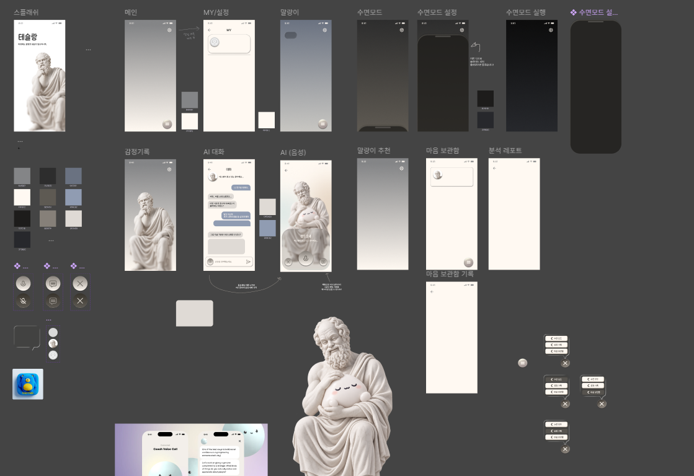
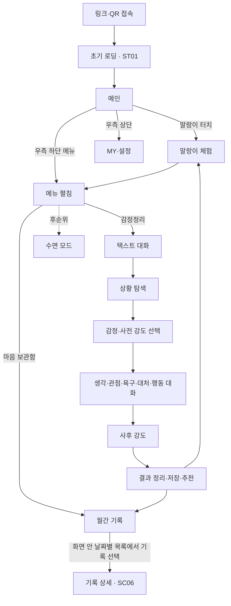

# 테슬랑 화면 디자인 기준

> v0.3 · 2026-11-14 (KST) · 단일 로그인 범위·기본 9개 화면 산정 반영
>
> 사용자가 선택한 최신 시각 방향, 기획·디자인 담당자의 설명, 기존 PRD의 제품 동작을 구분해 정리했다. 화면에 아직 없는 요소와 구현용 임시 수치는 제안으로 표시한다. 모든 화면의 최종 디자인 승인이나 서버 연동 완료를 의미하지 않는다.

## 1. 근거와 적용 범위

| ID | 자료 | 확인 범위 |
|---|---|---|
| V01 | [사용자가 첨부한 피그마 전체 화면](docs/design/figma-overview-2026-11-14.png) | 1119×768 이미지. 화면 구성·색감·캐릭터·아이콘·프레임 이름을 확인. 작은 카피와 정확한 레이어 수치는 확인 범위 밖 |
| V02 | [기획·디자인 담당자 설명](docs/design/담당자전달사항-2026-11-14.md) | 사용자가 전달한 설명 전문. 예정 동작과 작업 중인 부분을 구분 |
| V03 | [팀 Figma, node 71:244](https://www.figma.com/design/vmbKI4ltraNNxZSlhmg27N/?node-id=71-244) | 원본 위치. 연결 도구는 접근 권한 오류, 브라우저 조회는 창 식별 오류·시간 초과로 상세 확인하지 못함 |
| V04 | 2026-11-14 사용자 전달 백엔드 논의 | 사용자 구분·정보 저장을 위한 로그인 한 가지를 제공한다는 방향. 여러 소셜 연동은 이번 필수 범위 제외. 구체 인증 방식·구현 완료는 확인되지 않음 |
| P01 | [기존 PRD](prd.md) | v1.2의 화면 목록과 D01~D26 결정. 단일 로그인 범위를 적용하고 미정 인증 방식은 구분 |
| N01 | [노션 자료집](docs/notion/README.md) | 원문 기획·대화 규칙의 보조 근거. 노션만 보관한 자료와 최신 디자인 설명을 섞어 덮어쓰지 않음 |

V03의 프로토타입 토글을 직접 실행하거나 폰트·프레임 크기·색상 스타일·컴포넌트 속성을 추출한 것은 아니다. V02의 ‘토글 가능’, ‘AI 대화 거의 완성’은 담당자의 설명으로 기록한다. ‘내일 작업’은 전달 메시지의 원래 작성 시점을 모르므로 확정 납기로 바꾸지 않는다.

### 상태 표시

- **채택된 시각 방향:** 이번 이미지 전체를 기준으로 진행하겠다는 사용자 지시.
- **담당자 예정안:** V02에 설명했지만 완성된 상세 화면·작동 여부까지 확인하지 못한 내용.
- **기존 적용 기준:** PRD에 반영된 제품 동작. 이번 그림의 빈칸만으로 취소하지 않는다.
- **첫 시안 제안:** 화면을 빠르게 확인하기 위한 임시 배치·수치·문구. 팀 최종 확정과 구분.
- **추후 범위:** 이번 필수 화면의 완료 조건에 자동 추가하지 않을 기능.

시각 표현은 V01·V02를 따른다. 기능 동작이 P01과 다르면 충돌을 표시하고, 최신 그림이 있다는 이유만으로 기존 결정을 바꾸지 않는다. 이전 보라색 시안은 이번 기본 팔레트로 사용하지 않는다. 이번 갱신은 로컬 PRD·design의 화면 목록 정리다. Figma·Notion 원본 수정이나 앱 구현은 포함하지 않는다.

## 2. 디자인 방향 분석

아이보리 바탕, 중성 회색과 블루그레이, 하얀 소크라테스 석상, 부드러운 말랑이, 원형 버튼이 중심이다. 메인과 만지기 화면은 넓은 여백과 그라데이션으로 캐릭터에 집중시키고, 대화·설정·기록은 밝은 단색 바탕으로 읽기 편하게 나누는 방향이다. [V01, V02]

| 유지할 특징 | 화면에서의 역할 | 구현할 때 주의할 점 |
|---|---|---|
| 석상과 말랑이의 조합 | 테슬랑의 얼굴과 대화 상대 표현 | 소크라테스 이미지가 실제 조작 가능한 말랑이 자산을 대신하지 않음 |
| 적은 수의 원형 버튼 | 메인에서 시선 분산을 줄임 | 아이콘만 있는 버튼도 이름과 충분한 터치 영역 필요 |
| 아이보리 대화 배경 | 긴 텍스트를 읽는 화면에 일관성 부여 | 얇고 작은 회색 글씨를 이미지 그대로 축소하지 않음 |
| 블루그레이 사용자 말풍선 | 사용자와 AI 발화를 구분 | 밝은 글씨를 얹으면 대비가 약할 수 있어 실제 크기로 확인 |
| 유리처럼 반투명한 패널 | 음성·수면 화면의 분위기 | 텍스트 영역은 읽을 수 있는 불투명도 확보, 흐림 효과가 없어도 내용 유지 |
| 메인과 체험의 배경 변화 | ‘보기’와 ‘직접 만지기’ 상태 구분 | 배경색만으로 현재 모드를 알리지는 않음 |

메인·대화·캐릭터의 시각 방향은 충분히 보인다. 반면 감정 선택, 전후 점수, 전체 결과 정리, 달력·상세, 설정 내부는 이번 이미지와 설명만으로 최종 배치를 확정하기 어렵다. 이 부분은 아래에 첫 시안 제안을 별도로 적었다.



## 3. 먼저 만들 범위

| 순서 | 화면 묶음 | 이번 작업 기준 |
|---|---|---|
| 1 | 메인·원형 메뉴·말랑이 자리 | 최신 색감과 여백을 확인. 실제 말랑이는 담당자의 자산·인터랙션과 연결할 자리부터 확보 |
| 2 | 텍스트 대화·감정 선택·전후 강도·행동 선택 | 핵심 화면. 실제 대화 흐름에 필요한 입력 상태까지 함께 제작 |
| 3 | 결과 정리·추천·말랑이 체험 연결 | 추천 캐릭터 중심 디자인을 유지하며 PRD의 요약·정리 항목 포함 |
| 4 | 월간 보관함·날짜별 목록·기록 상세·개별 삭제 | 이번 버전의 기록 기능. 빈 상태·저장 실패·삭제 실패도 고려 |
| 5 | MY/설정·도움 연결 | 설정 공통 틀과 도움 화면 구성. 설정 내부 메뉴는 담당자 후속 시안에 맞춤 |
| 병행 | 단일 로그인 | SC09 기본 틀을 준비. 필드·가입 단계·API는 백엔드 방식 확정 후 반영 |
| 별도 | 음성 대화 | 통화형 UI와 기능 구상 보존. 첫 텍스트 시안의 필수 완료 조건에 포함하지 않는 안을 제안 |
| 후순위 | 수면 모드 | 담당자도 우선순위에서 제외. 메뉴·어두운 배경·설정 패널 구조만 자료로 유지 |
| 후순위 | 누적 분석 레포트·주간 기록 | 월별 누적 분석은 PRD에서 후순위. 화면 틀이 있다고 자동 포함하지 않음 |

첫 시안은 정적 목업 데이터로 확인할 수 있으나, 실제 저장·AI 응답·음성 연결이 되는 것처럼 표시하지 않는다. 감정 목록과 추천 매핑은 샘플임을 개발용 시안에서 구분한다. 시안 확인을 위해 로그인 공급자를 임의로 확정하지 않는다.

### 3.1 화면 목록과 산정 기준

2026-11-14 화면 목록 정리 기준이다. [노션 상세기능표](docs/notion/주제별/상세기능표.md), [전달받은 Figma 전체 이미지](docs/design/figma-overview-2026-11-14.png), [기획·디자인 담당자 설명](docs/design/담당자전달사항-2026-11-14.md)을 대조했다. Figma 원본 레이어·토글은 접근 제한으로 직접 확인하지 못했으므로 ‘디자인 없음’은 **전달받은 자료에서 확인되지 않음**을 뜻한다. 이전보다 최신 수정본을 실시간 조회했다는 의미는 아니다.

**이번 제작 기준은 독립 화면 최소 9개(SC01~SC09)**다. 기존 서비스 화면 8개에 단일 로그인 진입 화면 SC09를 포함한 산정안이다. 백엔드 답변에 따라 사용자 구분·정보 저장을 위한 로그인 한 가지를 구현하고, 여러 로그인 수단이나 카카오·구글 등 소셜 연동은 이번 필수 구현 범위에서 제외한다. [D26]

**9개는 최종 전체 화면 수가 아니라 현재 잡을 수 있는 기본 화면 수**다. 이메일/아이디 등 식별자, 비밀번호·인증 방식, 가입·약관·프로필을 한 화면에 넣을지 분리할지는 아직 정해지지 않았다. 가입 등 별도 화면을 채택하면 그만큼 늘어난다. 이전의 8개는 인증 화면을 제외한 수치였으며 전체 개발량으로 해석하면 안 된다.

산정 규칙:

- 독립 화면은 목적·본문·진입/복귀 흐름이 구분되는 화면이다. URL을 반드시 하나씩 만들어야 한다는 뜻은 아니다.
- 메인과 직접 조작 모드는 역할이 달라 SC01/SC02로 분리한다. 말랑이 세 종류는 SC02 안의 종류·상태로 센다.
- 감정·사전 강도·행동·사후 강도는 SC03의 입력 상태, 결과·추천은 SC04 하나로 구성하는 첫 시안 기준이다.
- 선택 날짜의 상담 목록은 SC05 안에 표시하고 개별 기록을 열 때만 SC06으로 이동한다.
- 스플래시는 초기 상태(ST01), 메뉴·선택 시트·확인창은 OV 항목이다. 전체 화면을 덮더라도 독립 화면 수에 더하지 않는다.
- 색·폰트·시안이 있다는 것과 개발에 필요한 모든 상태·자산이 준비됐다는 것은 다르다. 현재 완성 인계본으로 검증한 화면은 없다.

#### 독립 화면 — 기본 제작 9개

| 화면 ID | 독립 화면 | 주요 기능·근거 | 이번 제작 범위 | 현재 디자인 근거와 부족한 부분 |
|---|---|---|---|---|
| SC01 | 메인 | 명세 1.2, 2.4 말랑이 메뉴 | 포함. 말랑이·감정정리·보관함 진입, 설정 연결 | **기본 시안 있음.** 배경·메뉴 위치 확인. 중앙 말랑이 실제 자산·배치 검수 필요 |
| SC02 | 말랑이 체험 | 명세 2.1~2.3, 3.1~3.2; PRD D21~D23 | 포함. 세 종류를 한 화면의 종류·상태 변화로 처리. 효과음은 권장 | **배경·틀과 설명만 있음.** 종류 선택 UI, 실제 자산·변형·잠금 상태 보완 필요 |
| SC03 | 텍스트 AI 대화 | 명세 5.1.1, 5.2~5.3, 6.1; 노션 AI 문서; PRD D03~D17 | 포함. 감정·전후 강도·행동 선택은 화면 안 카드/상태로 포함 | **기본 시안 있음.** 프로필·말풍선·입력창 확인. 구조화 입력 카드·로딩·실패·종료 상태 보완 필요 |
| SC04 | 상담 결과·말랑이 추천 | 명세 5.3, 6.1, 7.1~7.2, 9.1; PRD D19~D20 | 포함. 전체 요약·항목별 정리·전후 점수·추천·저장 상태를 한 화면에 구성 | **틀과 설명만 있음.** ‘말랑이 추천’ 프레임은 있으나 완성된 결과 구성 미확인 |
| SC05 | 마음 보관함 | 명세 8.1.1, 8.1.3, 8.2.1 | 포함. 월간 달력과 선택 날짜의 상담 목록을 한 화면에 구성 | **틀과 설명만 있음.** 달력·상담 목록·날짜 선택·빈 상태를 디자인해야 함 |
| SC06 | 기록 상세 | 명세 8.2.2~8.2.5, 8.3.1; PRD D24 | 포함. 저장된 결과 조회·개별 삭제. 실제 사용 말랑이 이력 범위는 미정 유지 | **빈 프레임 수준.** ‘마음 보관함 기록’ 프레임만 확인. 내용 배치·삭제 UI 필요 |
| SC07 | MY/설정 | 담당자 설명의 설정 이동, 명세 12 및 16~17의 관련 기능 | 공통 화면 틀 포함. 안내·도움 연결 위치 확보. 계정 세부 기능은 범위 확정 후 반영 | **틀만 있고 내부 작업 중.** 상단 카드 외 메뉴 구성 미확인. 로그인 방식·탈퇴 등을 임의 추가하지 않음 |
| SC08 | 도움 연결 | 기획안 위험 대응, system.v4·AI 문서, PRD R-SAFETY | 포함. 위험 감지 시 전환하고 평소에도 접근 가능 | **대응 디자인 미확인.** 전달 이미지에 프레임 없음. 안내·연결 버튼·복귀 경로 디자인 필요 |
| SC09 | 로그인 | 명세 13·15, PRD R-AUTH; 전달받은 백엔드 답변 D26 | 포함. 사용자 구분·정보 저장을 위한 로그인 한 가지. 세부 입력 필드·검증·진입 시점은 미정 | **대응 디자인 미확인.** 기본 인증 진입 화면부터 설계. 이메일·아이디·간편 비밀번호 등의 구체 방식을 임의 확정하지 않음 |

#### 팝업·메뉴·시트 — 독립 화면 수에서 제외

| UI ID | 팝업·메뉴·시트 | 소속 화면 | 적용 상태 | 디자인 준비 상태 |
|---|---|---|---|---|
| OV01 | 원형 메뉴 펼침 | SC01·SC02 | 이번 포함. 별도 페이지 아님 | 열린/닫힌 모습 확인. 실제 토글 동작은 직접 검증하지 못함 |
| OV02 | 말랑이 종류 선택 | SC02 | 종류 변경 포함. 드롭다운/시트 등 표현 방식은 첫 시안 설계 대상 | 버튼 위치 설명만 있음. 목록·선택·잠금 상세 미확인 |
| OV03 | 안내·약관 내용 보기 | SC07·SC09 및 가입 흐름 | 첫 시안에서는 재사용 시트로 분류. 가입 약관 동의 절차·본문 확정과는 별개 | 대응 시안 미확인. 전문 상담 대체 아님 고지와 개인정보 안내를 구분 |
| OV04 | 대화 종료 확인 | SC03 | **제공 여부 미정.** 확인창 있음/없음 비교 대상 [D13] | 대응 시안 미확인. 종료 버튼 제공과 확인창 채택은 별개 |
| OV05 | 기록 삭제 확인 | SC06 | 삭제 기능은 포함. 확인창은 **첫 시안 제안**, 최종 채택 미정 | 대응 시안 미확인. 삭제 실패·재시도도 별도로 필요 |
| OV06 | 수면 설정 패널 | 후순위 수면 화면 | 후순위. 담당자 설명상 아래에서 여는 패널 | 패널 틀 있음. ASMR·음원·타이머 컨트롤 미완성 |
| OV07 | 로그아웃 확인 | SC07 | 로그인·계정 관리 범위 확정 후. 명세 17-1-2의 후순위 기능 | 대응 시안 미확인 |

OV는 7개 후보 유형을 관리하는 목록이며 확정 팝업 7개라는 뜻이 아니다. OV01~03은 이번 화면 구성에 필요한 표현 방식(OV02~03의 시트 형태는 제안), OV04~05는 채택 미정인 확인창, OV06~07은 후순위/조건부다.

#### 화면 안 상태 — 독립 화면 수에서 제외

| UI ID | 화면 안 상태·영역 | 소속 | 이번 범위와 디자인 상태 |
|---|---|---|---|
| ST01 | 초기 로딩·스플래시·초기 실패 | 앱 진입 → SC01 | 초기 로딩 포함. 스플래시 시안 있음. 실제 실패·재시도 상태 미확인. 독립 탐색 화면으로 세지 않음 |
| ST02 | 대화 입력 대기·전송·AI 응답 대기·통신 실패 | SC03 | 포함. 일반 말풍선 외 처리 중·실패 UI 보완 필요 |
| ST03 | 대표·부가 감정 선택 | SC03 | 포함. 대표 1개 필수·부가 최대 1개 선택. 목록 미정. 전용 입력 UI 미확인 |
| ST04 | 사전 강도 입력 | SC03 | 포함. 0~10, 미선택 시작. 버튼/카드 시안 필요 |
| ST05 | 행동 선택지 | SC03 | 포함. AI 선택지 응답에 연결. 문장형 버튼·선택 후 상태 미확인 |
| ST06 | 사후 강도 입력 | SC03 | 포함. 점수 건너뛰기는 기존 조건부 적용안. 전용 UI 미확인 |
| ST07 | 결과 생성·저장 중·저장 성공/실패·점수 미입력 | SC03 → SC04 | 포함. 별도 ‘저장 완료 페이지’ 추가하지 않음. 상태 UI 미확인 |
| ST08 | 월 이동·날짜 선택·해당 날짜 목록·빈 기록·조회 오류 | SC05 | 포함. 날짜별 목록은 달력 아래 영역으로 산정. 상세 시안 필요 |
| ST09 | 상세 조회 중/실패·삭제 중/실패/성공 | SC06 | 포함. 기록 상세 본문과 함께 설계 필요 |
| ST10 | 말랑이 종류·해금/잠금·자산 로딩/실패·변형 | SC02 | 포함할 종류와 조작 기준 유지. 세 종류를 세 페이지로 세지 않음 |
| ST11 | 첫 이용 안내·데이터 활용 안내 | SC03·SC07·SC09 및 가입 흐름 | 기존 안내 요구 유지. 인라인 안내/OV03 보기로 분류. 화면·최종 카피 미확인 |
| ST12 | 인증번호·재전송·검증 오류·가입 단계·로그인 오류 | SC09 및 가입 흐름 | 인증 방식 결정 후 상세화. 이메일 인증을 채택할 때의 상태를 별도 페이지로 미리 확정하지 않음 |

ST는 상태 묶음 12개를 추적하는 목록이다. ST01~11은 이번 화면 설계에 포함하고, ST12는 인증 방식 결정 후 구체화한다. 각 행 안에 여러 세부 상태가 있으므로 이 숫자를 작업량이나 최종 시안 장수로 해석하지 않는다. 상태 컴포넌트를 여러 화면에서 재사용할 수 있다.

#### 미정·후순위 — 기본 9개와 별도 관리

| 후보 ID | 참고 화면·기능 | 현 분류 | 기본 9개와의 관계·추가 조건 |
|---|---|---|---|
| AU01 | 로그인·인증 진입 | SC09로 편입, 중복 산정 안 함 | 단일 로그인 제공은 D26으로 결정. 구체 방식·입력 필드·진입 시점은 남은 확인 |
| AU02 | 가입·식별자·인증 정보 입력 | 구체 방식과 화면 분리 여부 미정 | 이메일 방식 확정 아님. 이메일을 채택하면 인증번호 등 ST12를 검토. 별도 가입 화면이면 기본 9개에 추가 |
| AU03 | 가입 약관·프로필 설정 | 인증 흐름에서 구성 결정 | 명세 14~15의 기능. SC09/AU02와 합칠지 분리할지 미정. 약관 ‘보기’ OV03이 동의 절차 전체를 대체하지 않음 |
| AU04 | 비밀번호 찾기/변경·탈퇴 | 별도 범위 확인·후순위 | 명세 16의 후순위/보류. 기능 수를 독립 화면 수로 환산하지 않음 |
| DF01 | 감정기록 시작 소개 | 채택 미정 | Figma의 ‘감정기록’ 석상 화면. 첫 시안은 SC03 직접 진입으로 산정. 별도 소개를 채택하면 독립 화면 수 재계산 |
| DF02 | AI 음성 | 제공 범위 미정 | 화면 시안은 있음. 통화형 음성은 명세의 단순 음성 입력보다 넓은 구상. 채택하면 화면·연동 범위 추가 |
| DF03 | 수면 모드 | 후순위 | ‘수면모드’와 ‘수면모드 실행’은 한 화면의 준비/실행 상태, 설정 프레임은 OV06으로 분류한 안. 최종 구조 미정 |
| DF04 | 분석 레포트 | 누적 분석이면 후순위 | 프레임만 있음. 단일 상담 결과를 뜻한다면 SC04/SC06와 통합할 수 있어 의미부터 확인 |
| DF05 | 사진 커스텀 말랑이 | 후순위 | 명세 2.4 커스텀 기능. 업로드/편집 시안 미확인. SC02 기본 세 종류에 포함하지 않음 |
| DF06 | 주간 기록·숨김·복구 | 후순위·별도 범위 | 명세 8.1.2·8.3.2~3. 채택하더라도 우선 SC05/SC06의 보기·상태로 검토 |

AU·DF 행은 기능/흐름 후보이며 행 수가 추가 화면 수는 아니다. 로그인 한 가지 제공은 결정됐으며 세부 인증·가입·약관 구성은 미정이다. 미정이라는 이유로 필요한 인증·동의 절차를 생략하거나 비회원 체험을 자동 허용하지 않는다.

#### 대분류 17개와 화면 수가 다른 이유

명세의 17개 대분류는 **기능 묶음**이다. 17개의 페이지를 지시하는 목록이 아니다. 아래 대응표처럼 어떤 기능은 같은 화면에 모이고, 어떤 기능은 화면 없이 처리되며, 후순위 기능은 이번 화면 수에서 빠진다.

- ‘5. 감정 기록’과 ‘6. AI 맞춤 조언’은 SC03 대화·SC04 결과에 나뉘어 들어간다.
- ‘7. 말랑이 추천’은 SC04 결과에 포함하고 체험은 SC02로 연결한다.
- ‘8. 마음 보관함’ 한 묶음은 SC05 보관함·SC06 상세의 두 화면이 된다.
- ‘9. 감정 데이터’의 저장·사용자별 분리는 서버 처리와 각 화면의 저장 상태다. 별도 데이터 페이지가 아니다.
- ‘12. 개인정보’·‘14. 약관 동의’는 안내/동의 내용이며 SC07 설정·인증 흐름·OV03에 나눠 담는다. 동의 기능을 없앤다는 뜻이 아니다.
- ‘13. 회원 인증’·‘15. 계정 생성’은 SC09와 추가 가입 구성으로 묶되, 가입 화면의 분리 여부는 미정이다.
- ‘16. 계정 관리’·‘17. 로그아웃’은 설정의 기능과 확인 UI가 될 수 있다. 각각 한 페이지로 자동 계산하지 않는다.
- ‘4. 수면’·‘10. 감정 패턴 분석’·‘11. 누적 개인화’는 후순위다. 반대로 기획의 도움 연결 SC08은 명세 대분류에 없어도 필요하다.

독립 화면 9개 외에도 입력 카드·메뉴·팝업·로딩·오류·빈 상태를 제작해야 한다. 따라서 ‘9개만 그리면 전부 끝’이라는 작업량 견적은 아니다. 전체 17개 기능 묶음의 포함·보류·대응 위치는 아래 표로 추적한다.

#### 노션 주요 기능의 화면 대응

| 명세의 기능 묶음 | 대응 화면·상태 | 범위 처리 |
|---|---|---|
| 1. 메인화면 | SC01, ST01 | 포함 |
| 2. 말랑이 만지기·메뉴 | SC02, OV01~02, ST10 | 세 종류 기본 체험 포함, 부가 조작 일부 미정. 사진 커스텀 DF05 |
| 3. 말랑이 ASMR | SC02의 사운드 컨트롤 | 권장. 별도 화면 아님 |
| 4. 수면 모드 | DF03, OV06 | 후순위 |
| 5. 감정 기록 | SC03~04, ST02~04·ST06~07 | 텍스트 포함. 음성은 DF02 |
| 6. AI 맞춤 조언 | SC03~04, ST05 | 이번 대화의 행동·관점 정리 포함 |
| 7. 말랑이 추천 | SC04 → SC02 | 포함 |
| 8. 마음 보관함 | SC05~06, OV05, ST08~09 | 월간 조회·상세·개별 삭제 포함, 주간·숨김·복구 DF06 |
| 9. 감정 데이터 | SC04~06의 저장·조회·삭제 상태 | 서버 처리와 연결. 별도 ‘데이터 화면’ 추가 안 함 |
| 10. 감정 패턴 분석 | DF04 | 누적 분석 후순위 |
| 11. 개인화 케어 | DF04 | 과거 기록 기반 개인화 후순위. 이번 상담의 조언과 구분 |
| 12. 개인정보 | SC07, OV03, ST11; SC06 개별 삭제 | 데이터 활용 안내·삭제 정책 별도 확인. 탈퇴·전체 데이터 삭제와 구분 |
| 13. 회원 인증 | SC09, AU02, ST12 | 단일 로그인 포함 [D26]. 구체 방식·가입 분리 여부 미정 |
| 14. 약관 동의 | AU03, OV03 | 동의 흐름과 본문 보기 구분 |
| 15. 계정 생성 | SC09 및 AU02~03, ST12 | 계정 생성과 로그인 관계 확정 후 가입 단계·추가 화면 수 반영 |
| 16. 계정 관리 | AU04, SC07 | 후순위/보류, 설정 틀과 구분 |
| 17. 로그아웃 | SC07, OV07 | 기존 후순위. 독립 ‘로그아웃 화면’ 추가 안 함 |
| 명세 외 노션 기획·AI 문서의 위험 대응 | SC08 | 필수. 상세기능표에 별도 행이 없다고 누락하지 않음 |

#### 아직 필요한 디자인

- **기본 시안이 있는 2개:** SC01 메인, SC03 텍스트 대화. 실제 말랑이 자산과 입력·오류 상태 보완은 여전히 필요하다.
- **틀만 있거나 설명을 더해야 하는 5개:** SC02 체험, SC04 결과·추천, SC05 보관함, SC06 기록 상세, SC07 설정. 특히 SC06은 빈 프레임 수준이다.
- **대응 프레임이 확인되지 않는 2개:** SC08 도움 연결, SC09 로그인.
- **프레임과 별도로 빠진 핵심 UI:** 감정 선택(ST03), 사전·사후 강도(ST04·06), 행동 선택(ST05), 저장 상태(ST07), 날짜별 상담 목록(ST08), 조회·삭제 실패(ST09), 종류 선택·잠금(OV02·ST10).
- **지금 기본 틀을 설계할 항목:** SC09 로그인. **방식 결정 후 구체화할 디자인:** 로그인 입력·검증과 가입·약관·프로필(AU02~03). 종료 확인창(OV04)은 제공 여부부터 미정이며, 삭제 확인창(OV05)은 시안 제안이다.

기획·디자인에 우선 보완받을 묶음은 **대화 입력 카드 → 결과 정리 → 달력·상세 → 설정·도움 연결**이다. 프론트는 그동안 SC01/SC03의 기본 틀과 공통 컴포넌트를 만들 수 있다. 이 순서는 제작 순서 제안이며 추가 제품 기능을 확정하지 않는다.

### 3.2 현재 Figma 참고 프레임과의 대응

| 첨부 이미지의 프레임 이름 | 개발용 분류 | 산정 |
|---|---|---|
| 스플래시 | ST01 초기 상태 | 독립 화면 아님 |
| 메인 | SC01 | 1개 |
| MY/설정 | SC07 | 1개, 내부 내용 미완성 |
| 말랑이 | SC02 | 1개, 세 종류 공통 |
| 감정기록 | DF01 별도 시작 소개 후보 | 첫 시안에서는 제외, SC03 직접 진입 |
| AI 대화 | SC03 | 1개, 감정·점수·행동 입력 상태 포함 |
| AI (음성) | DF02 | 범위 미정, 기본 9개 제외 |
| 말랑이 추천 | SC04 결과·추천 | 1개. PRD의 상담 정리 내용까지 보완 |
| 마음 보관함 | SC05 | 1개, 날짜별 상담 목록을 내부에 표시 |
| 마음 보관함 기록 | SC06 | 1개 |
| 분석 레포트 | DF04 | 누적 분석이면 후순위 |
| 수면모드·수면모드 실행 | DF03 준비/실행 상태 | 후순위. 두 프레임을 자동으로 두 페이지로 세지 않음 |
| 수면모드 설정·관련 패널 컴포넌트 | OV06 | 후순위 오버레이 |
| 도움 연결 | SC08 | 기획상 필요하지만 첨부 이미지에는 대응 프레임 미확인 |
| 로그인 | SC09 | D26에 따라 포함. 첨부 이미지에는 대응 프레임 미확인 |

아이콘 변형, 색상표, 메뉴 열림/닫힘 컴포넌트, 캐릭터 원본 이미지, 외부 참고 캡처는 독립 화면으로 세지 않는다. 원본의 레이어 종류를 조회한 결과가 아니라 전달 이미지의 시각 구성을 개발 단위에 대응한 표다.

### 3.3 문서 간 관리

PRD 5.5와 이 절은 같은 SC/OV/ST/AU/DF ID를 사용한다. 기능 포함 여부는 PRD, 배치·상태 표현은 이 문서의 뒤쪽 상세 절을 함께 적용한다. ST03/04/05/06을 별도 전체 화면으로 나누기로 결정하면 SC 수를 다시 계산한다. 화면을 만드는 동안 추가된 로딩·오류 상태를 새 페이지 수에 섞지 않는다.

## 4. 색상·타이포·공통 규격

### 4.1 색상 표본

아래 HEX는 V01의 평평한 색상표 중앙 픽셀을 표본 추출한 값이다. **Figma 레이어의 원본 색상값을 읽은 결과가 아니다.** 이미지 압축·색상 변환 가능성을 고려해 첫 시안용 근삿값으로 사용하고 원본 조회가 가능해지면 대조한다. 이름은 구현 편의를 위한 제안이다.

| 토큰 제안 | 표본값 | 용도 제안 |
|---|---|---|
| `surface-base` | `#FFF9F2` | 대화·설정·기록의 기본 아이보리 배경 |
| `surface-muted` | `#DFDAD5` | AI 말풍선, 보조 카드 |
| `accent-chat` | `#909CB2` | 사용자 말풍선, 선택 상태의 블루그레이 |
| `slate` | `#6A7281` | 말랑이 모드 배경의 짙은 쪽 후보 |
| `gray` | `#848587` | 메인 배경의 짙은 쪽 후보 |
| `warm-gray` | `#868079` | 원형 컨트롤·중간 톤 |
| `text-primary` | `#2D2D2D` | 본문·제목 |
| `text-secondary` | `#5E5A53` | 설명·보조 문구 |
| `sleep-dark` | `#1D1C1B` | 수면 준비 화면의 어두운 쪽 후보 |
| `sleep-slate` | `#27282C` | 수면 실행 화면의 어두운 쪽 후보 |

메인은 회색에서 아이보리로 밝아지는 세로 그라데이션, 말랑이 화면은 푸른 회색에서 밝은 중성색으로 이어지는 분위기를 따른다. 위 두 색을 정확한 그라데이션 끝점으로 확정한 것은 아니다. 실제 stop 위치·각도·알파는 미확인이다.

블루그레이 말풍선의 본문은 첫 시안에서 `text-primary`로 시작하는 안을 제안한다. V01에서 보이는 밝은 글씨를 그대로 적용할 경우에는 실제 모바일 크기에서 읽기성을 따로 확인한다. 선택 상태는 색 외에 체크·테두리·문구를 함께 사용한다.

### 4.2 화면 규격 — 첫 시안 제안

| 항목 | 임시 기준 | 비고 |
|---|---|---|
| 기준 화면 | 폭 390px, 높이 844px에서 우선 확인 | 원본 Figma 프레임 크기라는 뜻이 아님 |
| 반응형 확인 | 폭 360·390·430px 및 가로 회전 | 고정 캔버스 비율로 전체 화면을 축소하지 않음 |
| 큰 화면 | 콘텐츠 폭 약 480px 이내로 중앙 배치 | 모바일 중심 첫 시안의 제안값 |
| 좌우 여백 | 20px, 좁은 화면에서는 16px | 입력창·카드·헤더 기준선 정렬 |
| 간격 | 4·8·12·16·24·32px | 임시 공통 간격 |
| 본문 | 16px, 줄높이 약 1.5 | 말풍선 긴 문장 줄바꿈 허용 |
| 제목 | 20~24px, 보조 제목 18px | 석상 이미지와 경쟁하는 큰 제목 남발 금지 |
| 보조 글 | 13~14px | 상태·날짜·짧은 안내용 |
| 글꼴 | 우선 시스템 한글 산세리프 | Figma 글꼴·굵기·자간 미확인. 외부 폰트 임의 확정 안 함 |
| 아이콘 버튼 | 보이는 도형과 별개로 터치 영역 약 44~48px | 최소 터치 영역의 프로젝트 제안값, Figma 측정값 아님 |
| 말풍선·카드 | 모서리 16~20px 후보 | 원형 컨트롤은 원형 유지 |

휴대폰 브라우저 상·하단 UI, 노치·홈 인디케이터, 키보드가 표시돼도 입력창과 주요 버튼이 가려지지 않게 한다. 시안 속 9:41·배터리·통신 아이콘은 OS 모형이므로 실제 웹 안에 다시 그리지 않는다. 모션은 약 150~250ms의 짧은 전환을 첫 시안 후보로 두되, AI 응답 시간과 별개로 취급한다.

## 5. 전체 이동 구조



이 그림은 정상 흐름과 첫 시안 연결안이다. 로그인 삽입 위치는 미정이다. 질문 단계는 이미 확인한 내용에 따라 건너뛸 수 있으며, 위험 감지·종료·저장 실패는 아래 별도 상태를 따른다. 감정정리 시작 소개 화면은 생략한 첫 시안 제안으로 표시했으며 최종 채택으로 간주하지 않는다.

## 6. 로딩·메인·메뉴

### 6.1 로딩/스플래시 — ST01

- V01에는 ‘테슬랑’ 제목과 소크라테스 석상이 보인다. 작은 설명 카피는 정확히 판독되지 않아 확정 문구로 복사하지 않는다.
- 초기 자산 준비 상태에 사용한다. 정해진 시간만큼 일부러 기다리게 하는 연출은 요구되지 않았다.
- 실패하거나 오래 걸릴 때 빈 화면에 고정되지 않도록 다시 시도할 경로를 둔다. 대기 시간 수치는 구현 중 정한다.

### 6.2 메인 — SC01

- 회색→아이보리 계열 배경, 중앙 말랑이 하나, 우측 상단 설정 버튼, 우측 하단 원형 메뉴. [V01, V02]
- 첫 시안의 말랑이 영역은 가로폭 약 60~70%를 후보로 잡고 중심부에 배치한다. 최종 크기는 실제 자산을 보고 조절한다.
- 말랑이 이미지를 누르면 체험 화면으로 전환한다. 메인에서 누른 동작이 체험 화면의 첫 변형 동작까지 뜻하는지는 미정이므로 중복 조작을 자동 전제하지 않는다.
- 석상 이미지를 메인 말랑이로 임의 대체하지 않는다. 실제 자산이 없으면 별도 표시한 자리 표시자를 사용한다.
- 첫 사용자에게 메뉴 기능이 보이지 않는 문제가 생기면 짧은 보조 라벨을 시안으로 비교한다. 새 온보딩 단계를 필수로 추가하지 않는다.

### 6.3 메뉴 펼침 — OV01

담당자 설명상 항목은 **수면모드 / 감정정리 / 마음 보관함**이다. V01에서는 원형 버튼 위로 작은 가로형 항목들이 쌓이는 상태와 닫기 아이콘을 확인할 수 있다. 세부 토글 애니메이션은 확인하지 못했다.

첫 시안 제안: 같은 위치에서 열고 닫으며, 항목을 선택하면 메뉴를 닫고 이동한다. 바깥 영역 클릭·닫기 버튼으로 닫고, 메뉴 뒤의 말랑이에 터치가 전달되지 않게 한다. 키보드 초점도 열린 항목으로 이동할 수 있어야 한다.

수면모드는 시각 확인용 시안에 표시할 수 있으나, 실제 사용자용 첫 버전에서 미구현이면 숨김 또는 ‘준비 중’으로 구분한다. 누르면 동작할 것처럼 보이는 빈 연결은 두지 않는다. 이 노출 정책은 첫 시안 제안이며 담당자 최종 메뉴 확정과 별개다.

## 7. 말랑이 체험 — SC02

- 메인과 다른 블루그레이 계열 배경으로 전환한다. 설정 버튼보다 아래에 종류 변경 버튼을 배치하고, 중앙 말랑이를 크게 조작하게 한다. 우측 하단 메뉴는 유지한다. [V02]
- 프론트 공통 화면은 배경·헤더·메뉴·종류 선택을 담당하고, 말랑이 담당 작업은 실제 변형·터치·렌더링 영역에 연결하는 구조를 제안한다. 이는 협업 경계 제안이며 담당자 배정 변경이 아니다.
- 세 종류(슬랑이·스퀴시·왁뿌볼)를 실제 체험 가능한 상태로 만드는 것이 기존 목표다. 추천된 종류 외 이미 열린 종류도 선택할 수 있으나 잠긴 종류를 임의 해금하지 않는다. [P01 D21, D23]
- 말랑이 조작 중에는 해당 영역의 제스처를 처리하고, 메뉴·종류 선택·페이지 이동을 위한 터치까지 막지 않는다.
- 회전·리셋 등 부가 버튼은 ‘복잡한 버튼 없이’라는 방향과 기존 PRD의 미정 범위를 함께 고려한다. 새 버튼을 기본 화면에 늘리지 않는다.
- 기본 말랑이 복원 시간은 노션에 5초/6초 차이가 남아 있다. 최종 모션 수치로 고정하지 않는다. 효과음은 권장이며 필수 완료 조건은 아니다. [P01 D22]

자산 인계 시 필요한 항목: 종류 ID, 실제 파일·렌더러 형태, 기본 크기·투명 배경 여부, 로딩·실패 처리, 종류 전환과 해금 상태 연결 방식. 특정 3D 엔진·파일 형식은 아직 선택하지 않는다.

## 8. 텍스트 대화 — SC03

### 8.1 화면 구조

```text
┌──────────────────────────┐
│ ← 나가기                 │
│ [소크라테스] 대화          │
│             상태 문구     │
│                          │
│ [AI 말풍선]              │
│          [내 말풍선]      │
│ [필요한 입력 카드]        │
│                          │
├──────────────────────────┤
│ (음성*) 입력창     전송    │
└──────────────────────────┘
```

아이보리 바탕, AI 왼쪽·사용자 오른쪽 말풍선, 소크라테스 프로필, 하단 입력창을 적용한다. 음성 아이콘은 담당자 예정안에 있으나 실제 노출·동작은 13장의 범위 구분을 따른다. 고정된 대본을 제품 대화로 사용하지 않는다.

첫 시안에서 헤더와 입력창은 유지하고 대화 목록을 스크롤한다. 대화가 길어져도 입력창을 화면 아래로 밀어내지 않는다. 사용자가 이전 메시지를 읽고 있다면 새 응답마다 강제로 맨 아래로 이동시키지 않고, 새 메시지로 이동할 수 있는 안내를 제공하는 안을 제안한다.

### 8.2 대화 시작

V02는 별도 ‘감정기록 시작하기’ 화면과 바로 대화 진입 사이에서 고민 중이다. **첫 시안은 바로 대화로 들어가고 첫 안내를 채팅 안에 넣는 안을 제안**한다. 별도 소개 화면이 최종 확정됐다는 뜻은 아니다.

초기 카피 후보: ‘어떤 일이 있었는지 편하게 이야기해 주세요.’ 첫 사용자 메시지를 보내기 전에는 채팅 UI만 열고, 서버 상담 세션 생성은 기존 첫 메시지 기준과 맞춘다. 별도 시작 화면을 생략해도 최초 이용 고지는 빠뜨리지 않는다.

### 8.3 상태·입력·오류 — 첫 시안 제안

| 상태 | 표시 후보 | 입력·버튼 동작 |
|---|---|---|
| 입력 대기 | ‘이야기를 기다리고 있어요’ | 입력창 사용 가능. 빈 문자열·공백만 있으면 전송 비활성 |
| 메시지 전송 중 | 전송 중 표시 | 동일 메시지 중복 전송 방지 |
| AI 응답 대기 | ‘생각을 정리하고 있어요’ + 작은 점 표시 | 질문 추가 전송은 막고, 초안 입력은 보존하는 안 |
| 답변 표시 중 | 실제 스트리밍을 제공할 때만 표시 | 스트리밍 미지원이면 가짜 입력 중 상태를 오래 재생하지 않음 |
| 감정·점수·행동 선택 | 해당 입력 카드 | 필요한 구조화 입력을 채팅 텍스트로 대신 처리하지 않음 |
| 통신 실패 | ‘답변을 받지 못했어요. 다시 시도해 주세요.’ | 보낸 내용 보존, 재시도와 종료 경로 제공 |
| 위험 신호 | 도움 연결 화면 | 일반 질문·점수·추천 흐름보다 안전 대응 우선 |

텍스트 모드에서는 마이크를 사용하지 않으므로 ‘듣는 중’이라는 표시가 실제 녹음을 뜻하는 것처럼 보이지 않게 한다. AI 상태는 실제 요청 상태에 연결한다. 노션의 단계 전환은 재호출이 생길 수 있으므로 잠시 기다림이 보여도 같은 질문을 두 번 렌더링하지 않는다.

입력창은 내용에 따라 몇 줄까지 늘어나고 이후 내부 스크롤하는 형태를 제안한다. 전송 아이콘에 접근 가능한 이름을 제공하고, 한글 조합 중 Enter가 메시지를 전송하지 않도록 한다. Enter·줄바꿈 동작은 실제 모바일 키보드로 확인한다.

## 9. 감정·강도·행동 입력 — SC03 내부 상태

이 화면은 V01에서 완성된 별도 설계를 확인하지 못했다. 아래 구성은 기존 제품 기준을 지키면서 채팅 안에 입력 카드를 넣는 **첫 시안 제안**이다. 최종 카드/바텀시트 채택은 실제 화면을 보고 조정한다.

### 9.1 감정 선택

- 구체적인 상황이 나온 뒤 감정 선택을 요청한다. 시작부터 감정 선택으로 보내지 않는다. [P01 D03]
- 대표 감정 1개 필수, 부가 감정 최대 1개 선택. 부가 감정 없이 진행 가능. [D04]
- ‘대표 감정’과 ‘함께 느낀 감정 · 선택’을 분리해 같은 두 개짜리 체크박스로 오해하지 않게 한다.
- 목록에서만 고른다. 직접 입력 칸은 제공하지 않는다. 최종 목록은 백엔드 답변 대기다. [D07]
- 카드의 선택값은 확인 버튼 전까지 임시 선택으로 보여준다. 제출 뒤 감정 수정 가능 여부는 미정이므로 이미 제출한 감정을 자유롭게 수정할 수 있다고 약속하지 않는다.
- UI 샘플 감정은 디자인 확인용이며, 추천 표의 6개나 예시의 9개를 최종 목록으로 고정하지 않는다.

### 9.2 사전·사후 강도

담당자는 채팅 입력과 버튼 선택을 검토 중이다. **첫 시안은 0~10 숫자 버튼을 선택하는 방식**을 제안한다. 기존 요구가 사용자 직접 입력이라는 뜻이지, 숫자를 자유 텍스트로 해석해야 한다는 뜻은 아니다.

첫 시안 배열: 0~5 / 6~10의 두 줄 버튼과 선택값 표시, 다음 버튼. 좁은 폭에서도 각 버튼의 터치 영역을 확보한다. 슬라이더는 대안으로 남기되 처음부터 5점이 선택돼 있는 것처럼 보이지 않게 해야 한다.

- 사전·사후 모두 미선택으로 시작. 사용자가 선택한 0과 미선택은 다르다. [D08]
- 전후 점수는 0~10 정수 한 쌍. 대표 감정만의 강도로 새롭게 한정하지 않는다. 기존 기준은 백엔드 문서 준용이며, 전후의 ‘감정의 크기/마음의 무게’ 표현 차이가 남아 있다. [D06]
- 양끝 임시 문구: ‘0점: 전혀 느껴지지 않음 / 10점: 매우 강하게 느껴짐’. 최종 카피 미정. [D09]
- 사전 점수는 입력 후 진행. 사후 점수 건너뛰기는 **백엔드에 큰 변경이 없다는 조건을 확인해야 하는 기존 적용안**이다. 첫 시안에서는 동작을 비교할 수 있지만 실제 API가 지원한다고 표시하지 않는다. [D10]
- 사후 점수를 생략하면 결과·상세에 ‘입력하지 않음’으로 표시하고 변화량을 계산하지 않는다. 0이나 사전 점수로 채우지 않는다.

### 9.3 행동 선택

AI가 행동을 떠올리기 어려운 사용자에게 선택지를 제공하면 메시지 아래 세로형 버튼으로 보여주는 안을 제안한다. 긴 문장은 줄바꿈하고, 버튼은 한 줄 높이에 억지로 맞추지 않는다.

선택지 개수는 확정되지 않았으므로 응답 데이터에 맞춰 렌더링한다. 사용자가 말한 구체적 행동과 휴식 선택도 인정한다. 새 관점·행동을 강제하거나 AI가 대신 선택하지 않는다. 카드 선택 후 연속 탭으로 동일 답이 여러 번 보내지지 않게 한다.

## 10. 나가기·종료·위험 상태

V02는 나가기 버튼을 ‘메인메뉴로 돌아가기’라고 설명하지만, 기존 PRD는 **화면 안 뒤로가기를 대화 마무리로 연결**한다. 이 차이는 미해결 사항으로 남긴다. 첫 시안은 기존 종료 처리를 적용하며, 버튼 문구와 최종 도착 화면은 팀 확인 대상이다.

| 상황 | 기존 기준 | 화면 적용 |
|---|---|---|
| 감정 선택 전 종료 | 결과·추천 생성 안 함, 사후 점수 요구 안 함 [D11] | 메인 복귀를 첫 시안 목적지로 제안. 데이터 삭제 의미로 안내하지 않음 |
| 감정 선택 후 종료 | 사후 점수 → 정리·결과. 건너뛰기는 조건부 적용안 | 즉시 메인으로 이동해 마무리 절차를 없애지 않음 |
| 종료 확인창 | 최종 미정 [D13] | ‘계속 대화 / 대화 마무리’ 시안과 확인창 없는 시안을 비교. 제작자가 임의로 최종 확정하지 않음 |
| 브라우저 종료 후 재접속 | 이전 대화 이어하기 제외 [D15] | 새 대화를 시작. 기존 세션 자동 삭제까지 뜻하지 않음 |
| 위험 감지 | 일반 상담 중단, 도움 연결 | 감정 선택·사후 점수·결과 유도보다 우선. 평소 메뉴·설정에서도 도움 정보에 접근 가능하게 설계 |

브라우저 자체 뒤로가기·새로고침·일시적 연결 끊김은 화면 안 나가기와 별개로 미정이다. 이번 문서에서 자동으로 같은 동작으로 묶지 않는다. 도움 화면의 실제 연락 수단은 제공 전 확인하고, AI가 전문 상담·치료를 대신하지 않는다는 고지는 최초 이용 및 설정에 반영한다.

### 10.1 도움 연결 — SC08

위험 신호가 감지되면 진입하고, 평소 SC07의 도움 연결에서도 접근할 수 있게 구성한다. 독립 화면으로 우선 산정했지만 완성된 Figma 시안은 확인하지 못했다. 첫 시안은 짧은 공감·안전 안내, 도움 연결 수단 목록, 서비스의 역할 안내와 복귀 경로를 담는 구조로 제안한다.

실제 연락 수단·최종 안내 문구·복귀 시 세션 처리 방식은 제공 전 확인한다. 일반 추천 화면을 재사용해 체험이나 결과 저장을 먼저 요구하지 않는다. 임의 연락처를 실제 연결 버튼에 넣지 않으며, 로딩/연결 실패 상태와 평상시 조회 상태를 구분한다. SC08이 독립 화면 목록에 있다는 사실만으로 문구·연결 계약까지 확정됐다는 뜻은 아니다.

## 11. 결과 정리와 말랑이 추천 — SC04

V02의 방향은 ‘추천 말랑이를 크게 배치하고 짧은 조언, 캐릭터 터치 시 체험’이다. 다만 이 설명만으로 구현하면 기존 PRD의 상담 결과 항목이 빠진다. **캐릭터 중심 화면에 상담 정리를 함께 배치하는 첫 시안**을 제안한다.

권장 시안 순서:

1. 짧은 전체 요약 1~2줄.
2. 추천 말랑이 크게 배치, 종류명과 체험 동작 표시.
3. 사용자가 정한 작은 행동 또는 휴식 한 줄. ‘조언’은 저장된 내용과 연결하며 새로운 처방을 임의 생성하지 않음.
4. 전후 점수. 사후 미입력이면 변화량 없이 표시.
5. ‘대화 정리’ 영역: 상황, 선택한 감정, 기존 생각, 새로운 관점, 욕구, 대처, 실천 행동.
6. 저장 상태와 기록함 이동.

위 순서·접기 여부는 제안이며 아직 완성된 디자인이 아니다. 한 화면 높이에 모든 내용을 압축하지 않고 세로 스크롤을 허용한다. 기본 화면에서는 짧은 요약·추천을 먼저 읽고 항목별 정리까지 확인할 수 있게 한다. 긴 AI 답변을 말줄임으로 영구 숨기지 않는다.

추천 캐릭터 자체를 눌러도 체험으로 이동하되, 클릭 가능한 요소임을 ‘이 말랑이 만져보기’ 등의 임시 라벨로 알린다. 최종 추천 사유의 생성 주체는 미정이다. 별도 사유가 없으면 임의로 분석 이유를 만들어 붙이지 않는다.

정리 완료 시 자동 저장하며 말랑이 체험은 저장 조건이 아니다. [D19] 저장 대기·완료·실패를 구분하고 실패인데 ‘기록했어요’라고 안내하지 않는다. 실패 시 결과 화면의 내용을 보존하고 재시도 경로를 제안한다. 중복 저장 방지 계약은 서버와 맞춘다.

## 12. 마음 보관함·기록 상세·설정

### 12.1 월간 보관함 — SC05

- 아이보리 배경과 상단 요약 카드 자리, 중앙 달력은 V01·V02 방향이다. 실제 달력과 상세 데이터 배치는 아직 작업 중이다.
- 첫 시안 제안: 월 제목과 이전/다음 이동, 7열 달력, 기록이 있는 날짜 표시, 선택 날짜의 상담 목록.
- 하루 여러 상담은 한 날짜를 누르면 해당 날짜 목록을 먼저 보여주는 안을 제안한다. 확정 제품 규칙으로 단정하지 않는다.
- 날짜 선택 표시는 숫자·테두리를 함께 사용하고, 기록 여부와 선택 여부를 구분한다. 감정을 색깔 하나로만 설명하지 않는다.
- 빈 보관함에는 ‘아직 기록이 없어요’와 감정정리 진입을 제공하는 안을 제안한다. 기록 없는 날짜와 로딩 실패를 같은 상태로 보여주지 않는다.
- 월간 달력 조회는 포함, 주간 보기와 누적 통계는 후순위다.

상단 ‘테스형 분석 레포트’는 무엇을 분석하는지 확인이 필요하다. 여러 상담을 모은 패턴 분석이라면 기존 후순위와 충돌한다. 첫 시안에서는 **누적 분석 카드 대신 최근 상담 요약 카드로 연결하는 대안**을 제안하되, 이를 담당자의 확정 의도처럼 기록하지 않는다. 실제 누적 분석이 없는데 개인 분석 결과를 만들어 표시하지 않는다.

### 12.2 기록 상세 — SC06

날짜·시간, 전체 요약, 감정, 전후 점수, 상황·생각·새로운 관점·욕구·대처·행동, 추천 말랑이를 확인할 수 있게 한다. 결과 화면의 정리 컴포넌트를 재사용하는 안을 제안한다. 미확보 항목은 빈 상태로 처리하고 AI가 채워 넣지 않는다.

본인 기록 한 건 삭제는 포함한다. 삭제 대기·성공·실패를 구분하고 성공 전에는 목록에서 영구 삭제된 것처럼 안내하지 않는다. 삭제 확인창은 종료 확인창과 별개이며, 첫 시안에 확인 단계를 두는 안을 제안한다. 원 대화·AI 데이터까지 지워지는 범위가 미정이므로 ‘모든 데이터가 완전히 삭제됩니다’ 같은 문구는 쓰지 않는다.

### 12.3 MY/설정 — SC07

우측 상단 톱니바퀴 → MY/설정 이동은 담당자 예정안이다. 상단 프로필 카드와 밝은 배경은 V01에서 확인되지만 내부 내용은 작업 중이다.

첫 시안은 뒤로가기·제목·프로필 자리까지 구성한다. 최초 이용 고지와 도움 연결 등 기존 요구가 들어갈 위치를 확보한다. 단일 로그인 제공은 D26으로 정해졌지만 구체 인증 방식과 계정 수정·로그아웃·탈퇴 범위는 미정이다. 이메일·소셜 버튼이나 계정 삭제를 임의로 완성 기능으로 추가하지 않는다. 데이터 활용 안내는 일반 AI 안내와 구분한다.

### 12.4 단일 로그인 — SC09

**적용 범위 [D26, V04]:** 사용자 정보를 구분·저장할 수 있는 로그인 한 가지를 제공한다. 여러 소셜 로그인은 이번 필수 구현 대상이 아니다. 기본 화면 수는 서비스 화면 8개에 로그인 진입 1개를 더한 9개로 관리한다.

현재 전달 자료에는 로그인 디자인이 없다. 첫 시안은 아이보리 배경, 서비스명·짧은 안내, 한 가지 로그인 절차의 입력/진입 영역, 진행 버튼, 오류 표시 자리를 준비한다. 카카오·구글·Apple 버튼을 나란히 배치하지 않는다. 입력 필드 이름·개수·비밀번호 유무·인증번호 입력은 아직 임시 확정하지 않는다.

이메일인지 아이디인지, 처음 사용하는 사람이 계정을 어떻게 만드는지, 약관·프로필을 어느 단계에서 받는지에 따라 AU02~03을 SC09 내부 단계로 넣거나 추가 독립 화면으로 나눌 수 있다. 가입 동작이 필요한데 로그인 화면만 만들고 가입을 누락하지 않는다. 로그인 실패·처리 중·세션 만료의 표시와 복귀 흐름도 인증 계약에 맞춰 구체화한다.

사용자 구분 목적이라는 표현만으로 닉네임 입력·자동 로그인·비회원 체험을 채택하지 않는다. 로그인 요구 시점과 로그인 상태 유지 정책은 미정이다. 실제 서버가 없는 첫 시안은 임시 상태임을 표시하고 운영 인증 완료처럼 처리하지 않는다.

## 13. 음성 대화 — 담당자 구상과 구현 범위 구분

담당자가 설명한 기능은 단순 ‘음성을 텍스트로 입력’보다 범위가 크다. 통화형 화면, AI 음성 출력, 사용자 음성 인식, 음소거, 통화 유지 중 채팅 표시와 실시간 대화 기록을 포함하는 구상이다. 기존 노션 명세의 음성 입력 P2만으로 이 전체가 이번 버전 확정이라고 볼 수 없다.

### 13.1 예정 화면

- 소크라테스 이미지 중심, 반투명 상태 패널, 통화 상태·시간 표시.
- 왼쪽 중단 / 가운데 음소거 / 오른쪽 채팅 버튼. [V02]
- 중단: 음성 모드를 끝내고 텍스트 대화로 복귀. **상담 전체 종료와 구분.**
- 음소거: 사용자 마이크 입력을 멈추는 의미. AI 소리까지 끄는 동작과 구분.
- 채팅: 음성 모드를 유지한 채 대화문을 펼치는 의미. 상담 세션을 새로 만들지 않는 방향.

### 13.2 실시간 기록 가능 여부

음성을 텍스트로 변환하는 처리와 AI 답변 이벤트를 같은 상담에 연결하면 가능한 구성이다. 다만 지금 백엔드가 지원한다고 확인한 것은 아니다. 사용자·AI 발화 구분, 인식 중 문장과 확정 문장, 시간 순서, 중복 방지, 음성 중단 후 미완료 발화 처리 계약이 필요하다. 임시 음성 인식 문장을 곧바로 최종 상담 기록으로 저장하는 방식은 피하는 안을 제안한다.

마이크 사용은 사용자 권한과 안전한 연결 환경이 필요하며 권한 거절·장치 없음 상태가 생길 수 있다. 브라우저 내장 `SpeechRecognition`은 널리 쓰이는 모든 브라우저에서 공통 지원되는 기능이 아니므로 이것만으로 모든 휴대폰의 실시간 음성 기능을 보장하지 않는다. [MDN: 마이크 입력](https://developer.mozilla.org/en-US/docs/Web/API/MediaDevices/getUserMedia), [MDN: SpeechRecognition](https://developer.mozilla.org/en-US/docs/Web/API/SpeechRecognition)

### 13.3 첫 시안 제안

텍스트 대화를 먼저 완성하고, 음성 화면은 별도 시각 시안으로 보존한다. 구현 전인 마이크 버튼은 실제 사용자용 화면에서 숨기거나 준비 중임을 분명히 표시하는 안을 제안한다. 실제 마이크·음성 서버가 연결되지 않은 상태에서 통화 시간·듣는 중·자막을 작동 중처럼 재생하지 않는다.

포함하기로 결정되면 연결 중·권한 요청·사용자 발화·AI 생각 중·AI 발화·음소거·연결 끊김·텍스트 복귀 상태를 추가로 설계한다. 기술 공급자·비용·전송·보관 정책·양방향 동시 발화 방식은 이번 문서에서 확정하지 않는다.

## 14. 수면 모드 — 후순위 화면 구조 보존

담당자 구상: 어두운 수면 진입 화면 → 아래에서 열리는 설정 패널 → ASMR·음원 등 선택 → 패널 아래 실행 버튼 → 더 어두운 실행 화면.

기존 기획에는 타이머로 소리·화면 효과를 종료하는 방향이 있다. 사용자의 브라우저나 앱 자체가 자동으로 닫히는 기능으로 해석하지 않는다. 음원 목록·기본 선택·타이머·정지·복귀 방식은 세부 시안과 구현 계약이 필요하다.

이번에는 텍스트 대화·결과·기록보다 우선하지 않는다. 배경 샘플과 패널 구조를 보관하되 수면 기능 완성이 메인·대화 첫 시안 완료를 막지 않도록 한다.

## 15. 공통 컴포넌트와 필수 상태

이름은 구현을 위한 제안이며 이미 존재하는 코드 컴포넌트가 아니다.

| 구성 요소 | 책임 | 준비할 상태 |
|---|---|---|
| 화면 틀 | 배경·상하단 안전 여백·본문 스크롤 | 밝은 화면, 그라데이션, 어두운 화면 |
| 원형 아이콘 버튼 | 메뉴·설정·전송·닫기 | 기본, 눌림, 초점, 비활성, 처리 중 |
| 펼침 메뉴 | 세로 메뉴 항목과 닫기 | 닫힘, 열림, 미제공 기능 |
| 말랑이 영역 | 자산 또는 렌더러 연결 | 로딩, 준비, 오류, 종류 전환 |
| 대화 헤더 | 소크라테스 프로필과 상태 | 입력 대기, 응답 대기, 오류 |
| 말풍선 | 사용자·AI 발화 | 짧은 글, 긴 글, 전송 중, 실패 |
| 입력 카드 | 감정·강도·행동 선택 | 미선택, 선택, 제출 중, 실패, 제출 완료 |
| 입력창 | 텍스트와 전송 | 빈 값, 한글 조합, 여러 줄, 비활성 |
| 결과 정리 | 요약과 항목별 내용 | 전체 내용, 미확보 항목, 사후 점수 없음 |
| 추천 카드 | 추천 종류·체험 이동 | 추천 있음, 불러오기 실패, 자산 로딩 |
| 달력·기록 목록 | 월·날짜·여러 상담 연결 | 로딩, 기록 있음, 기록 없음, 오류 |
| 안내창/시트 | 종료·삭제 등 별도 맥락 | 열림, 닫힘, 처리 중. 종료 확인창은 미정 유지 |

배경이 스크롤되거나 키보드가 올라올 때 컨트롤이 다른 컨트롤과 겹치지 않는지 확인한다. 터치뿐 아니라 키보드 초점·아이콘 이름·텍스트 확대도 고려한다. 말랑이의 반복 움직임은 줄일 수 있는 형태로 설계하는 안을 제안한다. 모든 상태를 실제 서버 기능으로 구현했다는 의미는 아니다.

## 16. 이번 설명과 PRD의 차이·남은 확인

| 항목 | 현재 상태 | 첫 시안에서의 처리 |
|---|---|---|
| 로그인 | 로그인 한 가지 제공 [D26]. 식별자·인증·가입 방식 미정 | SC09 기본 틀 포함. 소셜 버튼 목록을 만들지 않으며 가입 분리 시 화면 수 추가 |
| 감정정리 시작 화면 | 담당자 검토 중 | 바로 대화 진입 제안. 별도 소개 화면은 대안으로 보존 |
| 감정 강도 입력 UI | 채팅 숫자/버튼 중 미정 | 0~10 버튼 선택 제안. 미선택과 0 구분 유지 |
| 사후 점수 건너뛰기 | 기존 조건부 적용안, API 지원 미확인 | 시안 표시 가능. 운영 확정으로 취급하지 않음 |
| 대화 나가기 | 담당자 메인 이동 설명 / PRD 마무리 흐름 | 기존 종료 분기 유지. 최종 문구·도착 위치 확인 |
| 추천 화면의 결과 항목 | 담당자는 캐릭터·짧은 조언 중심 | PRD의 요약·항목별 정리·전후 점수 함께 배치 제안 |
| 분석 레포트 | 누적 분석인지 단일 상담 요약인지 불명확 | 누적 분석은 후순위 유지. 최근 기록 카드 대안 제안 |
| 음성 통화 | 단순 음성 입력보다 확장된 구상 | 별도 시각 시안, 실제 기능 포함 여부 미확정 |
| MY/설정 내부 | 담당자 수정·작업 예정 | 공통 틀부터, 내부 메뉴는 후속 시안 대조 |
| 수면 | 담당자가 후순위 명시 | 구조만 보관. 첫 구현의 완료 조건 제외 |
| 감정 목록·추천 | 최종 목록/매핑 미정 | 예시 데이터 구분, 임의 확정 안 함 |
| 원본 스타일·자산 | 상세 Figma 조회 미완료 | 표본 색과 임시 수치 표시, 원본 접근 시 교체·대조 |

이 항목들은 지금 모두 답을 받아야 시작할 수 있는 질문 목록이 아니다. 첫 화면은 지정한 임시값으로 만들고, 제품 흐름·서버 계약을 바꾸는 선택만 별도로 확정한다. 이번 디자인 채택을 로그인 방식이나 음성 서버 채택으로 확대하지 않는다.

## 17. 첫 시안 확인 기준

- [ ] 메인·대화·결과의 색감이 최신 아이보리·회색·블루그레이 방향으로 일관된다.
- [ ] SC09 단일 로그인 화면이 목록에 포함되고, 가입·약관 누락이나 미정 인증 방식의 임의 확정이 없다.
- [ ] 중앙 말랑이와 우측 하단 메뉴, 우측 상단 설정의 위치가 실제 휴대폰에서 자연스럽다.
- [ ] 메뉴 열림/닫힘과 페이지 이동을 눌러볼 수 있고 미구현 기능을 구분한다.
- [ ] 대화 입력창이 키보드·홈 인디케이터에 가려지지 않는다.
- [ ] 긴 사용자·AI 문장과 긴 행동 선택지를 읽을 수 있다.
- [ ] 대표 감정만 선택해도 진행할 수 있고, 최종 목록이 아닌 시안 데이터를 구분한다.
- [ ] 점수 미선택과 0점, 사후 점수 미입력을 서로 구분한다.
- [ ] 응답 대기·실패·재시도 상태가 있고 중복 전송을 막는다.
- [ ] 나가기가 기존 종료 기준을 건너뛰지 않는다. 확인창은 비교 대상임을 유지한다.
- [ ] 결과에 짧은 전체 요약·항목별 정리·추천·저장 상태가 함께 나타난다.
- [ ] 말랑이를 체험하지 않아도 저장된 결과를 기록함에서 확인할 수 있는 흐름이다.
- [ ] 달력·상세·개별 삭제의 빈 상태와 오류를 성공 상태와 구분한다.
- [ ] 음성·수면·누적 분석이 실제 제공 중인 기능처럼 오해되지 않는다.
- [ ] 석상·말랑이 자산, 미확정 문구·수치·상호작용을 최종 원본값으로 표시하지 않는다.

이 체크리스트는 앞으로 만들 시안을 확인하기 위한 기준이다. 현재 앱 구현·모바일 기기 검수·Figma 토글 검증을 완료했다는 기록이 아니다.
