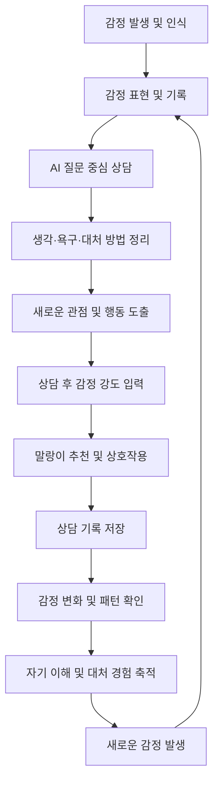

# 기획안

# 1.  서비스 개요

## **서비스명**

# **테슬랑**

## 서비스 한 줄 소개

#### *“AI와 함께 감정을 정리하고, 나만의 감정 패턴을 발견하여 더 나은 방향으로 나아갈 수 있도록 돕는 개인화 감정 케어 서비스”*

### 핵심 키워드

AI 감정 대화 · 생각 정리 · 감정 기록 · 개인화 · 감정 패턴 분석  · 말랑이 인터랙션

위 서비스는 사용자가 자신의 고민과 감정을 텍스트 또는 음성으로 기록하면, AI가 제공하는 질문과 대화를 통해 감정의 원인과 사고 과정을 구체화하고, 이후 축적된 사용자의 감정 기록들을 분석하여 개인에게 맞는 감정 케어 방향을 제공하는 **AI 기반 장기형 감정 케어 서비스**입니다.

기존 AI 서비스가 사용자의 고민에 즉각적으로 공감만 하고 조언을 준 후 대화가 종료되는 **일회성 상담 구조에 집중**한다면, 말랑이는 한 번의 대화에서 끝나지 않고 사용자의 감정 기록을 지속적으로 축적하여 **시간에 따른 감정 변화 반복적인 감정 패턴을 분석합니다.**

또한 AI 상담 이후 사용자의 감정 상태에 적합한 ‘말랑이’를 추천하고, 사용자가 직접 터치하는 식의 상호작용을 통해 말랑이의 형태를 변형시키는 인터랙션과 상황에 맞는 ASMR 사운드를 재생함으로 **인지적인 감정 정리와 감각적인 감정 환기를 하나의 경험**으로 연결시켜줍니다.

# 2.  서비스 배경 및 문제 정의

## 핵심 문제

#### 사용자는 자신의 감정을 충분히 이해하지 못한 채 감정을 소비하고 있으며, 한 번의 상담만으로는 반복되는 감정 문제를 해결하기 어렵습니다.

### ● 현대인의 감정 억압과 멘탈 번아웃

현대 2030 청년층은 SNS 속 완벽한 모습과 직장·학교 내 관계 유지 압박으로 인해 부정적 감정(분노, 불안, 우울, 억울함)을 솔직하게 분출하지 못하고 가면을 쓴 채 버팁니다.

### ● 기존 텍스트 중심 멘탈케어 서비스의 한계

기존 감정 일기 앱이나 심리 상담 서비스는 긴 텍스트 작성을 요구해 피로도가 높습니다. 감정을 기록한 뒤에도 즉각적인 신체적·감각적 해소감(카타르시스)을 주지 못해 리텐션이 급감합니다.

| **문제** | **내용** |
| --- | --- |
| 감정을 정확히 파악하기 어려움 | 단순히 ‘힘들다’, 짜증난다’ 정도로만 감정을 인식, 왜 그런지 생각하지 못 함 |
| 감정 기록의 한계 | 기록은 남지만 그 안에서 반복되는 패턴과 취약점을 발견하기 어려움 |
| AI 상담의 한계 | 일회성 공감이나 일반적인 조언에 그치는 경우가 많음 |
| 감정 관리의 지속성 부족 | 상담이 끝나면 이후의 감정 변화가 연결되지 않음 |
| 해결과 행동의 간극 | 감정을 이해해도 실제로 무엇을 해야 할지 모호함 |

# 3.  서비스 목표

위 서비스는 AI가 사용자의 감정을 직접 판단하고 해결해주는 서비스가 아닙니다.

AI가 적절한 질문을 제공하여 사용자가 자신의 감정을 직접 꺼내고, 문답을 통해 생각을 확장하며, 자신의 상황을 새로운 관점에서 바라볼 수 있도록 돕습니다.

이후 기록된 감정 데이터를 지속적으로 저장하고 분석하여 사용자가 스스로 발견하기 어려운 **개인의 감정 패턴과 취약점, 반복적인 스트레스 요인을 찾아내어 제공합니다.**

나아가 개인의 패턴을 찾아주고 사용자가 심리적으로 건강한 상태를 유지할 수 있도록 **맞춤형 조언과 공감**을 제시하며 **지속적인 감정 케어**를 제공합니다.

# 4.  핵심 서비스 컨셉

## “나를 대신해 해결해주는 서비스가 아니라, 나의 감정을 이해하도록 돕는 서비스”

서비스의 핵심은 AI의 조언이나 해결 방안이 아니라 질문/답변과 감정을 이해하고 수용하는 과정에 있습니다.

서비스의  AI는 사용자가 자신의 감정을 더욱 세부적으로 바라보고 돌아볼 수 있도록 전문적인 심리상담 기법과 소크라테스식 대화 방식을 참고하여 대화를 설계합니다.

# 5.  주요 타겟

### 자신의 감정을 혼자 정리하기 어려우며 전문적인 상담에는 부담을 느끼는 
10~30대 사용자

- 학업 및 취업 스트레스가 많은 학생·취준생
- 인간관계에서 감정 소모가 많은 사용자
- 자신의 감정을 글로 정리하기 어려운 사용자
- 전문적인 상담보다 가볍게 자신의 감정을 관리하고 싶은 사용자

| **사용자 유형** | **주요 상황** | **주요 니즈** |
| --- | --- | --- |
| 대학생 | 과제, 시험, 팀플 | 학업 스트레스 정리 |
| 사회 초년생 | 업무, 직장 인간관계 | 감정 소모 관리 |
| 취준생 | 취업, 미래에 대한 불안 | 불안 및 생각 정리 |
| 인간관계 고민 사용자 | 친구, 연애, 가족 | 관계에서 발생한은 감정 정리 |

### 핵심 니즈

“누군가에게 털어놓고 싶지만 부담스럽고, 혼자 생각하면 생각이 꼬여버린다.”

## 페르소나

# 6.  서비스 전체 구조

# 7.  메인 화면

| **항목** | **내용** |
| --- | --- |
| 기능 목적 | 서비스의 핵심 진입점 제공 |
| 진입 | 앱 실행 완료 후 |
| 주요 UI | 중앙 말랑이, 우측 하단 상세 메뉴 버튼 |
| 기본 상태 | 기본 말랑이 캐릭터가 중앙에 표시됨 |
| 사용자 선택 | 말랑이 터치 / 감정 기록하기 버튼 |
| 결과 | 선택한 기능의 플로우로 이동 |

### 핵심 원칙

메인 화면에서는 사용자가 말랑이를 만지며 지금 감정을 환기 시킬 것인지, 감정을 기록하는 것을 먼저 해서 생각 정리를 할 것인지를 선택할 수 있게 하여 사용자의 자율성을 존중하고, 복잡한 메뉴는 우측 하단의 버튼에 숨겨서 보다 사용하기 편하도록 합니다.

# 8.  핵심 사용자 플로우

### A. 말랑이 먼저 만지기

### B. 감정 먼저 기록하기

### C. 마음 보관함 열람하기

# 9.  말랑이 만지기

말랑이는 단순한 3D 모델이 아니라 **감정 환기를 위한 인터랙션 도구**로 활용합니다.

### 말랑이 종류 변경

| **항목** | **내용** |
| --- | --- |
| 진입 | 말랑이 만지기 화면 상단 버튼 |
| 기능 | 사용자가 사용할 말랑이 선택 |
| 제공 종류 | 슬랑이 / 스퀴시 / 왁뿌볼 / 커스텀 |
| 선택 결과 | 선택한 말랑이로 화면 변경 |
| 데이터 저장 | 사용한 말랑이 종류 저장 가능 |

## 9-1. 인터랙션

사용자의 터치와 드래그에 따라 말랑이의 형태가 변형되고, 이에 맞춰 촉각적인 느낌을 전달하는  ASMR 사운드를 제공한다.

### 말랑이

| **입력** | **동작** | **사운드** |
| --- | --- | --- |
| Tap | 터치 위치의 말랑이가 눌림 |  |
| Long Press | 터치 위치의 말랑이가 지속적으로 압축됨 |  |
| Drag | 드래그 방향에 따라 형태가 늘어남 |  |
| Release | 3초동안 조작이 없을 시 5초에 걸쳐서 원래 형태로 복원 (개발해보며 조정 필요) |  |
| 반복 터치 | 터치 위치의 말랑이가 눌리는 정도가 달라짐 |  |

### 스퀴시

| **입력** | **동작** | **사운드** |
| --- | --- | --- |
| Tap | 터치 위치의 스퀴시가 눌림  |  |
| Long Press | 터치 위치의 스퀴시가 지속적으로 압축됨 |  |
| Drag | 드래그 방향에 따라 형태가 늘어남 (말랑이보다 작은 변형) |  |
| Release | 3초동안 조작이 없을 시 3초에 걸쳐서 원래 형태로 복원 |  |
| 반복 터치 | 터치 위치의 스퀴시가 눌리는 정도가 달라짐 |  |

### 왁뿌볼

왁스가 깨진 후 스퀴시와 같은 인터랙션을 사용합니다. (스퀴시 위에 왁스를 덧씌움)

| **입력** | **동작** | **사운드** |
| --- | --- | --- |
| Tap | 터치 위치의 왁스가 깨짐 |  |
| Long Press | 왁스가 다 깨진 이후 스퀴시와 동일하게 작용 |  |
| Drag | 〃 |  |
| Release | 〃 |  |
| 반복 터치 | 터치 위치의 왁스가 연속적으로 깨짐 |  |

### 커스텀 말랑이

커스텀 사진 기능은 핵심 감정 케어 기능이 아니므로 개발 우선순위에서 제외됩니다

| 항복 | 내용 | **사운드** |
| --- | --- | --- |
| 기능 | 사용자가 사진을 입력하여 말랑이 외형으로 적용 |  |
| 입력 | 갤러리 사진 |  |
| 처리 | 사진 선택 → 말랑이 형태에 이미지 적용 |  |
| 결과 | 사용자 개인화 말랑이 생성 |  |
| 저장 | 사용자가 선택한 경우 저장/삭제 |  |

## 9-2 말랑이 종류 변경

| **종류** | **주요 감정** | **인터랙션 방향** |
| --- | --- | --- |
| 슬랑이 | 불안 / 우울 | 천천히 만지기 |
| 스퀴시 | 속상함 / 슬픔 | 부드럽게 누르기 |
| 왁뿌볼 | 분노 / 스트레스 | 강하게 누르기 |
| 커스텀 | 사용자 선택 | 사용자 지정 |

## 9-3.  말랑이 모드

말랑이 인터랙션을 진행하는 화면 우측 하단에 **원형 메뉴**를 통해 주요 기능들에 추가적으로 접근합니다. 이를 통해 사용자가 현재 **말랑이 화면을 벗어나지 않고 집중**할 수 있게 하며 주요 기능을 따로 이용할 수 있도록 합니다.

- **감정 기록하기: AI 감정 상담 진입**
- **수면 모드: ASMR 및 수면 기능**
- **마음 보관함: 과거 감정 기록 확인**

## 9-4 수면 모드

수면 모드는 감정 기록과 말랑이 인터랙션 이후 사용자가 **자연스럽게 휴식 상태로 전환**할 수 있도록 지원하는 기능입니다.

## 콘텐츠

- 백색소음
- 빗소리
- 자연음
- 말랑이 ASMR
- 수면 유도 음악

## 인터렉션

수면 모드가 활성화되면 말랑이는 일반 모드보다 **느린 속도로 움직이며 화면의 밝기와 움직임을 최소화**함니다.

말랑이는 **무드등과 같은 시각적을 효과**를 제공하여 사용자가 화면을 계속 조작하지 않고도 편안하게 머무를 수 있는 환경을 제공합니다.

## 타이머

사용자가 원하는 시간을 설정하면, **타이머 종료 후 사운드 및 화면 효과를 종료**하여 **수면을 방해하지 않도록** 합니다.

# 10.  감정 분석하기

AI는 사용자의 문제에 즉시 해결책을 제시하기보다 **질문을 통해 사용자가 스스로 생각을 확장할 수 있도록 합니다.**

| **항목** | **내용** |
| --- | --- |
| 목적 | 사용자가 자신의 감정을 스스로 이해하도록 지원 |
| 입력 | 사용자의 고민 및 답변 |
| 처리 | AI가 대화 맥락을 분석하고 질문, 공감 생성 |
| 출력 | 공감 + 질문 + 생각 정리 |
| 종료 조건 | 감정과 상황이 충분히 구체화되었다고 판단될 때 |

## 10-1.  AI 대화

[자료](https://app.notion.com/p/40f5b968a98b80e2a3a9cdda1608571d?pvs=21)

[추가사항](https://app.notion.com/p/40f5b968a98b8026b6f2e045ebc92fb8?pvs=21)

[AI 프롬포트](https://app.notion.com/p/AI-4125b968a98b803ea9e9df26bd97c7e6?pvs=21)

### 상담 서비스 개요

AI 상담 시스템은 **인지행동치료(CBT), 소크라테스식 대화법, 해결중심 단기치료(SFBT), 비폭력대화(NVC)**의 일부 원리를 결합한 대화형 감정 케어 기능입니다.

사용자가 자신의 고민과 감정을 자유롭게 표현하면 AI가 질문을 통해 **상황과 감정, 사용자의 사고 방식, 내면의 욕구**를 탐색합니다.

이후 사용자가 자신의 생각을 **다양한 관점**에서 바라보고, 기존에 **가지고 있던 강점과 대처 방법**을 발견하여 **현실적으로 실천할 수 있는 작은 행동을 선택하도록 지원**해줍니다.

상담 종료 후에는 **대화 내용을 구조화하여 저장**하고, **감정 상태에 적합한 말랑이를 추천**해줍니다.
축적된 데이터를 활용해 **사용자가 자신의 감정 변화와 반복적인 사고 패턴을 돌아볼 수 있도록 합니다.**

**서비스 핵심 목표**

- 감정의 언어화를 통한 자기 이해 증진
- 자동적 사고 탐색을 통한 인지적 유연성 향상
- 내면의 욕구 및 감정 유발 요인 파악
- 기존의 대처 능력과 강점 발견
- 실천 가능한 작은 행동 도출
- 말랑이 상호작용을 통한 감정 환기
- 누적 기록을 통한 개인별 감정 변화 및 사고 패턴 분석

### 통합 심리 상담 기법

AI는 4가지 접근법의 핵심 원리를 하나의 자연스러운 대화 흐름에 통합합니다.

| **적용 기법** | **주요 역할** | **서비스 적용** |
| --- | --- | --- |
| CBT (인지행동치료) | 생각·감정·행동의 관계 파악 | 자동적 사고 및 감정 유발 요인 분석 |
| 소크라테스식 대화법 | 스스로 생각을 검토하도록 유도 | 근거·반례·대안적 관점 탐색 |
| SFBT (해결중심 단기치료) | 강점 및 해결 가능성 발견 | 예외 상황·대처 능력·작은 변화 탐색 |
| NVC (비폭력 대화) | 감정 뒤에 있는 욕구 파악 | 사용자가 실제로 바랐던 것 탐색 |

### AI 상담 프로세스

| **데이터** | **설명** |
| --- | --- |
| Situation | 현재 어떤 상황인가? |
| Emotion | 어떤 감정을 느끼는가? |
| Trigger | 감정을 유발한 사건은 무엇인가? |
| Thought(**Alternative Thought)** | 그 상황에서 어떤 생각을 했는가? |
| Need | 사용자가 실제로 원했던 것은 무엇인가? |
| Intensity | 감정의 강도는 어느 정도인가? |
| Action | 현재 선택할 수 있는 행동은 무엇인가? |
| coping | 사용자가 비슷한 상황에서 어떻게 버텨왔는가? |

### STEP 01.  감정 및 상황 탐색

**목적:** 사용자가 자신의 고민과 상황을 부담 없이 표현하도록 유도한다. **(Situation)**

- 사용자가 경험한 사건 파악
- 당시 상황과 주변 환경 탐색
- 핵심 고민 및 어려움 확인
- 공감적 경청을 통한 감정 표현 유도

#### 질문 예)

> “그 상황에서 마음이 불편했던 일이 있었나요?”
”그 일이 있고 나서 계속 생각나는 장면이 있나요?”
> 

### STEP 02.  감정과 상황 구조화 (CBT)

**목적:** 상황에서 발생한 감정을 명확히 인식하고 상담 전 상태를 기록합니다.

- 대표 감정 1개 및 부가 감정 1개 선택 **(Emotion)**
- 감정 강도 0~10점 입력 **(Intensity)**
- 감정 유발 요소 탐색 **(Trigger)**
- 감정과 상황에 대한 생각 구분 **(Thought)**

감정 강도는 AI가 추정하지 않고 사용자가 직접 입력한 값을 기록합니다.

### STEP 03.  생각의 유연성 탐색 (소크라테스 대화법)

**목적:** 감정을 유발한 자동적 사고를 파악하고, 그 생각 뒤에 있는 사용자의 실제 욕구를 발견합니다.

- 상황에 대한 최초의 생각 탐색 **(Thought)**
- 생각을 뒷받침하는 근거 확인 **(Situation)**
- 반례 및 다른 해석 가능성 탐색 **(Alternative Thought)**
- 감정 뒤에 있는 욕구 파악 **(Need)**

#### 질문 예)

> “그 상황에서 가장 먼저 떠오른 생각은 무엇이었나요?”
”그렇게 생각하게 된 이유는 무엇인가요?”
”반대로 생각해보면 어떤가요?”
”그때 사실 가장 바랐던 건 무엇이었나요?”
> 

#### 핵심 설계

사용자가 처음 떠올린 생각과 상담을 통해 새롭게 발견한 생각을 별도의 데이터로 저장합니다.

| **구분** | **데이터** | **설명** |
| --- | --- | --- |
| 대화 전 생각 | **Thought** | 사건 당시 떠올린 자동적 사고 |
| 대화 후 생각 | **Alternative Thought** | 대화를 통해 새롭게 발견한 관점 |

### STEP 04.  해결 가능성과 작은 변화 발견 (SBFT)

**목적:** 사용자가 이미 가지고 있는 대처 능력과 해결 자원을 발견합니다. (**coping)**

- 문제가 덜했던 순간 탐색
- 지금까지 상황을 버텨 온 방법 확인
- 기존에 도움이 되었던 행동 파악
- 원하는 미래와 변화의 모습 구체화

#### 질문 예)

> “이런 상황에서도 지금까지 어떻게 버텨 왔나요?”
”힘들 때 조금이라도 도움이 되었던 방법이 있나요?”
”이 상황이 조금 나아진다면 가장 먼저 무엇이 달라질까요?”
”문제가 조금 덜 했던 순간은 언제였나요?”
> 

추후 기록이 누적되면 사용자에게 과거에 도움이 되었던 대처 방법을 다시 제안할 수 있습니다.

### STEP 05.  감정 정리 및 실천 (CBT+SBFT)

**목적:** 기존 생각을 새로운 관점으로 확장하고 현실적인 행동을 스스로 선택하도록 돕습니다. **(Action)**

- 기존 생각과 새로운 생각 비교
- 사용자가 수용할 수 있는 대안적 사고 정리
- 원하는 결과 구체화
- 실천할 수 있는 작은 행동 선택

#### 질문 예)

> “처음에는 이 상황을 어떻게 생각했는데, 지금은 달라진 부분이 있나요?”
”앞으로 어떤 상황이 되었으면 좋겠나요?”
”그렇게 되기 위해 지금 할 수 있는 작은 행동은 무엇이 있을까요?” or 작은 실천 행동 추천
> 

### STEP 06.  말랑이 추천 및 감정 환기

**목적:** 상담 내용을 정리하고 감정 상태에 적합한 말랑이와 연결합니다.

- 상담 결과 요약
- 새로운 관점 및 욕구 확인
- 실천 행동 추천
- 대화 후 감정 강도 재 측정
- 적합한 말랑이 추천 **(9-3 참조)**

상담 전후의 감정 강도 차이를 기록하여 사용자가 상담을 통해 자신의 감정 상태를 어떻게 경험했는지 확인할 수 있도록 해줍니다.

감정 정리가 끝나면 AI가 사용자의 고민과 상황에 맞는 행동 방향을 제공합니다.

중요한 것은 AI가 정의내리고 해결방안을 직접적으로 지시하는 것이 아니라 **사용자가 직접 선택 가능한 행동을 제안**하는 것입니다.

### STEP 07.  감정 기록 저장 및 패턴 분석

**목적:** 상담 내용을 장기적으로 축적하여 감정 변화와 반복되는 사고 패턴을 확인합니다.

- 날짜별 상담 데이터 저장
- 감정 및 강도 변화 기록
- 반복되는 감정 유발 상황 분석
- 반복적으로 나타나는 사고 패턴 분석
- 과거에 효과적이었던 대처 방법 재추천
- 월별 감정 변화 및 개인화 인사이트 제공

## 위험 대응 규칙

정신건강을 다루는 서비스이기 때문에, AI 대화 전체에 아래 규칙을 항상 적용합니다.

## 1. 위험 신호 감지

- 서버 규칙으로 먼저 검사하고, AI가 한 번 더 확인합니다. (AI 판단 하나에만 맡기지 않음)
- 감지 대상: 자해·자살 생각, 타인을 해치려는 생각, 학대·폭력 피해 등
- 애매한 표현은 위험 신호로 보고 처리합니다. 다만 "과제 때문에 죽겠다 ㅋㅋ"처럼 과장된 일상 표현이 분명하면 예외로 둡니다.

## 2. 감지했을 때 AI의 행동

- 진행 중이던 질문, 생각 정리, 다른 관점 찾기를 바로 멈춥니다.
- 사용자의 마음을 짧게 받아 준 뒤, 혼자 견디지 않아도 된다고 말하고 상담 연결 화면으로 넘어갑니다.

> “혼자 감당하지 않아도 괜찮아요.” 
“지금은 마음의 문제를 해결하기보다 안전하게 도움을 받는 것이 중요해요.”
> 
- 해결책 제시, 설득, 훈계, "괜찮아질 거예요" 같은 가벼운 위로는 하지 않습니다.

## 3. 상담 연결 화면

- 자살예방상담전화 109 (24시간)
- 정신건강위기상담전화 1577-0199 (24시간)
- 청소년 상담 1388
- 긴급 상황 112 / 119

화면을 닫아도 보관함이나 메뉴에서 언제든 다시 볼 수 있게 합니다.

## 4. AI가 항상 하지 않는 것

- 진단하거나 병명을 언급하지 않습니다.
- 약물, 치료 방법 등 의료적인 조언을 하지 않습니다.
- 자신을 상담사나 전문가라고 소개하지 않습니다.
- 사용자의 생각을 "잘못됐다", "비합리적이다"라고 평가하지 않습니다.

## 5. 서비스 고지

첫 사용 시와 설정 화면에 "이 서비스는 전문 상담이나 치료를 대신하지 않습니다"를 안내합니다.

## 6. 위험 기록 처리

- 위험 신호가 감지된 대화는 `risk_flag`로 표시해 저장합니다.
- `risk_flag` 기록은 개인화 인사이트에 사용하지 않습니다.
- 사용자가 지우면 다른 기록과 똑같이 삭제됩니다.

## AI 대화 생성 및 운영 규칙

AI가 일관되고 안전한 상담을 제공하기 위해 다음과 같은 공통 운영 원칙을 적용합니다.

| 구분 | 운영 규칙 |
| --- | --- |
| 대화 방식 | 한 번에 핵심 질문 하나를 제시 |
| 감정 공감 | 질문에 앞서 사용자의 감정 인정 |
| 정보 수집 | 이미 확인한 정보는 반복 질문하지 않음 |
| 사고 탐색 | 사용자의 생각을 직접 부정하지 않음 |
| 해결 과정 | 사용자가 직접 선택하도록 유도 |
| 대화 길이 | 사용자 반응에 따라 질문 깊이 조절 |
| 상담 종료 | 사용자가 충분히 정리했거나 중단을 원하면 종료 |
| 데이터 저장 | 실제 발화 및 사용자 확인 내용을 기반으로 저장 |
| 안전 관리 | 위기 신호 발생 시 일반 상담보다 안전 대응 우선 |

### 상담 종료 조건

다음 조건을 기준으로 상담을 마무리합니다.

- 핵심 상황과 감정이 확인된 경우
- 사용자의 욕구나 원하는 결과가 어느 정도 정리된 경우
- 새로운 관점 또는 생각을 발견한 경우
- 실천할 행동을 선택했거나, 현재는 행동보다 휴식이 필요하다고 판단한 경우
- 사용자가 상담 종료를 요청한 경우

모든 질문을 반드시 거쳐야 하는 것은 아니며, 사용자가 충분히 표현한 내용은 생략할 수 있습니다.

# 11.  마음 기록함

상담이 종료되면 구조화된 데이터를 기반으로 날짜별 감정 기록을 생성합니다.

## 11-1.  마음 기록함

#### 날짜별 감정 기록

- 상담 날짜 및 시간
- 대표 감정
- 대화 전 후 감정 강도
- 기존 생각과 새로운 관점
- 사용자가 선택한 대처 방법 및 행동
- 추천받은 말랑이
- 상담 요약

## 11-2.  감정 데이터 분석

#### 월별 감정 변화 분석

축적된 기록을 활용하여 월별 감정 변화와 반복적인 사고 패턴을 시각화합니다.

| **분석 항목** | **제공 내용** |
| --- | --- |
| 감정 빈도 | 한 달 동안 자주 나타난 감정 |
| 감정 강도 | 대화 전후 감정 강도 변화 |
| 상황별 감정 | 특정 상황에서 반복되는 감정 |
| 사고 패턴 | 자주 등장하는 자동적 사고 유형 |
| 대처 방법 | 사용자가 과거에 도움이 되었다고 응답한 방법 |
| 변화 추이 | 이전 기록과 비교한 감정 및 생각의 변화 |

## 11-2.  개인화 인사이트

서비스의 장기적인 차별성은 기록이 축적될수록 사용자가 자신의 감정과 대처 방식을 더 잘 이해할 수 있도록 지원하는 데 있습니다.

개인화 인사이트는 누적 데이터를 기반으로 사용자에게 자신의 감정 및 사고 경향을 이해하기 쉽게 전달하는 기능입니다.

#### 예시)

> “이번 달에는 타인의 반응을 걱정하는 생각이 자주 나타났어요.”
”과제나 학업과 관련된 상황에서 불안감이 반복적으로 나타났어요.”
”힘들 때 주변 사람들에게 이야기하는 것이 도움이 되었던 기록이 있어요.”
> 

개인화 분석은 충분한 데이터가 쌓인 이후 제공하며 대화 전후 감정 강도 변화만으로 AI 상담의 임상적 효과를 입증하거나 판단하지 않습니다.

# 12.  핵심 서비스 루프

### 12-1. 서비스 루프 정의

말랑이의 핵심 서비스 루프는 사용자가 감정을 표현하고, AI를 통해 생각을 정리하고, 말랑이와 상호작용한 뒤, 그 경험이 기록으로 축적되어 다음 이용에 활용되는 반복 구조입니다.

**감정 표현 → AI 감정 정리 → 말랑이 상호작용 → 기록 축적 → 자기 이해 → 재방문**

### 12-2. 핵심 서비스 루프 상세

| 단계 | 사용자 행동 | 서비스 반응 | 생성 데이터 |
| --- | --- | --- | --- |
| ① 감정 표현 | 고민과 현재 감정 입력 | 상황 및 감정 기록 시작 | Emotion_Record |
| ② AI 감정 정리 | AI 질문에 답변 | 생각·감정·욕구 탐색 | Conversation_Message |
| ③ 새로운 관점 발견 | 자신의 생각을 돌아봄 | 대안적 생각과 행동 정리 | Counseling_Result |
| ④ 감정 변화 확인 | 상담 후 감정 강도 입력 | 전후 감정 상태 비교 | Emotion_Record |
| ⑤ 말랑이 추천 및 이용 | 추천된 말랑이 만지기 | 캐릭터 반응 및 ASMR 제공 | Malangi_Usage |
| ⑥ 기록 축적 | 상담 종료 및 저장 | 날짜별 기록 관리 | 전체 상담 데이터 |
| ⑦ 자기 이해 | 과거 기록 확인 | 감정 변화 및 반복 패턴 확인 | 누적 기록 분석 |
| ⑧ 재방문 | 새로운 감정 발생 시 재이용 | 이전 기록을 참고한 개인화 경험 | 신규 Emotion_Record |

### 12-3. 핵심 서비스 루프 다이어그램

---

# 13. 서비스 루프의 핵심 진입 경로

말랑이는 AI 상담부터 시작하는 경로뿐 아니라, 말랑이를 먼저 만지며 감정을 환기하는 경로도 제공합니다.

### A. 감정 정리 우선 경로

메인 화면 → 감정 기록하기 → AI 상담 → 상담 결과 정리 → 말랑이 추천 → 말랑이 이용 → 기록 저장

**목적:** 자신의 감정과 생각을 언어로 정리하고 싶은 사용자에게 적합한 경로

### B. 감정 환기 우선 경로

메인 화면 → 말랑이 터치 → 말랑이 만지기 → 계속 이용 / 감정 정리하기 / 이용 종료

**목적:** 당장 고민을 설명하기 어렵거나 우선 편안하게 감정을 환기하고 싶은 사용자에게 적합한 경로

※ 말랑이를 먼저 이용하는 경로에서는 감정 선택이나 AI 상담을 강제하지 않습니다.

# 14.  차별화 포인트

말랑이는 고민에 대한 답변을 제공하는 데서 그치지 않고, **사용자가 자신의 감정을 이해하고 생각을 정리**하며 **직접 해결의 방향을 선택하도록 지원**해줍니다.

또한 AI 상담 이후 **말랑이 만지기 기능을 연결**하여 언어적으로 정리한 감정을 **촉각적 상호작용으로 표현하고 해소**할 수 있도록 합니다.

| **구분** | **일반 AI 상담** | **말랑이 AI 상담** |
| --- | --- | --- |
| 상담 방식 | 고민에 대한 답변 중심 | 심리적 접근법을 활용한 질문 중심 |
| 감정 이해 | 사용자가 표현한 감정 파악 | 상황·감정·생각·욕구 구조화 |
| 사고 탐색 | AI가 해결책 제안 | 사용자가 새로운 관점 발견 |
| 해결 과정 | 일반적인 조언 제공 | 기존 강점과 대처 방법 활용 |
| 감정 표현 | 텍스트 대화 중심 | AI 상담 + 말랑이 촉각적 상호작용 |
| 지속성 | 일회성 상담 중심 | 감정 기록 및 개인화 인사이트 |

# 15.  MVP 범위

### 15-1. MVP 개발 목표

해커톤의 제한된 개발 기간을 고려하여 모든 기능을 구현하기보다 서비스의 핵심 가치를 검증할 수 있는 최소 기능 제품(MVP)을 개발합니다

MVP의 핵심 검증 목표는 다음 세 가지입니다.

1. 사용자가 AI와의 대화를 통해 자신의 감정과 생각을 정리할 수 있는가?
2. 말랑이를 만지는 상호작용이 감정 환기 경험에 도움이 되는가?
3. 상담 전후의 감정 변화를 기록하고 확인할 수 있는가?

### 15-2. MVP 핵심 기능

| 구분 | 핵심 기능 | 주요 구현 내용 | 우선순위 |
| --- | --- | --- | --- |
| 사용자 | 회원가입 및 로그인 | 소셜 로그인 또는 이메일 로그인 | 필수 |
| 메인 | 메인 화면 | 말랑이 캐릭터, 감정 기록하기 진입 | 필수 |
| 감정 환기 | 말랑이 만지기 | 터치 및 드래그에 따른 캐릭터 반응 | 필수 |
| 감정 환기 | ASMR | 말랑이 상호작용에 따른 효과음 | 권장 |
| AI 상담 | 감정 및 상황 입력 | 텍스트 기반 고민 입력 | 필수 |
| AI 상담 | AI 감정 정리 | 질문을 통한 상황·생각·감정·욕구 탐색 | 필수 |
| AI 상담 | 대안적 생각 및 행동 제안 | 새로운 관점과 실천 가능한 행동 도출 | 필수 |
| 감정 기록 | 감정 강도 입력 | 상담 전후 0~10점 직접 입력 | 필수 |
| 말랑이 추천 | 개인화 말랑이 추천 | 상담 결과에 따른 말랑이 유형 추천 | 필수 |
| 기록함 | 상담 기록 저장 | 날짜별 감정 및 상담 결과 저장 | 필수 |
| 기록함 | 기록 상세 조회 | 과거 상담 결과 및 말랑이 확인 | 필수 |
| 안전 | 위기 신호 대응 | 위험 표현 감지 및 안전 안내 제공 | 필수 |

### 15-3. MVP 후순위 기능

개발 기간 내 핵심 경험을 완성하는 것을 우선으로 하며, 다음 기능은 개발 여건에 따라 제외하거나 후속 업데이트로 진행합니다.

| 기능 | 후순위로 설정하는 이유 |
| --- | --- |
| AI 사고 패턴 누적 분석 | 충분한 기록 데이터가 쌓여야 의미 있는 분석 가능 |
| 월별 감정 통계 | 초기에는 기록 저장과 조회 기능이 우선 |
| 과거 대처 방법 자동 추천 | 사용자별 대처 데이터가 누적되어야 정확도 향상 가능 |
| 커스텀 사진 말랑이 | 이미지 업로드 및 캐릭터 변환 기능의 개발 부담 |
| 다양한 말랑이 유형 | 핵심 상호작용 검증 후 확장 가능 |
| 수면 모드 및 백색소음 | 핵심 감정 케어 경험과 직접적인 연관성이 상대적으로 낮음 |
| 복잡한 알림 시스템 | 초기 MVP 검증에 필수적이지 않음 |

### 15-4. MVP 개발 원칙

- AI가 사용자의 감정이나 생각을 임의로 판단하지 않는다.
- 사용자가 말하지 않은 정보는 추측하여 기록하지 않는다.
- 감정 강도는 AI가 추정하지 않고 사용자가 직접 입력한다.
- 상담을 통해 새로운 생각을 강요하지 않고 사용자가 스스로 발견하도록 돕는다.
- AI 상담은 전문적인 심리 상담 및 치료를 대체하지 않는다.
- 위기 신호가 감지되면 일반적인 상담보다 안전 안내를 우선한다.

# 16.  기대 효과

### 16-1. 사용자 측면

| 기대 효과 | 상세 내용 |
| --- | --- |
| 감정 인식 능력 향상 | 막연한 감정을 구체적인 단어와 상황으로 표현 |
| 자기 이해 증진 | 감정이 발생한 원인과 그 안에 담긴 욕구 탐색 |
| 생각의 유연성 확보 | 한 가지 부정적인 관점에서 벗어나 다른 가능성 탐색 |
| 감정 환기 경험 | 말랑이 상호작용을 통해 일상적인 감정 환기 경험 제공 |
| 자기 대처 능력 강화 | 과거에 효과적이었던 대처 방법을 돌아보고 활용 |
| 감정 변화 확인 | 상담 전후의 감정 강도와 기록을 통해 변화 확인 |

### 16-2. 서비스 측면

| 기대 효과 | 상세 내용 |
| --- | --- |
| 차별화된 감정 케어 경험 | AI 대화와 촉각적 캐릭터 상호작용의 결합 |
| 지속적인 서비스 이용 | 일회성 상담에서 벗어나 감정 기록을 통한 재방문 유도 |
| 개인화 서비스 기반 확보 | 기록 데이터 축적을 통한 개인별 감정 패턴 분석 기반 마련 |
| 서비스 확장성 | 향후 수면, ASMR, 커스텀 캐릭터 등으로 기능 확장 가능 |

### 16-3. 사회적 측면

- 심리적 어려움을 겪는 사용자가 자신의 감정을 표현할 수 있는 낮은 진입장벽의 환경 제공
- 감정 관리와 자기 이해의 중요성을 일상적으로 인식할 수 있도록 지원
- 심리적 도움을 요청하는 것에 대한 부담을 낮추는 보조적인 감정 케어 수단 제공

※ 위 기대 효과는 서비스가 제공하고자 하는 가치이며, 임상적 치료 효과나 정신건강 개선을 보장하는 것은 아닙니다.

## 17.  핵심 성과 지표

### 17-1. KPI 설정 목적

MVP의 성과는 단순 다운로드 수나 회원가입 수보다 사용자가 실제로 핵심 기능을 이용하고, 감정 정리 경험을 완료하며, 서비스를 다시 이용하는지에 초점을 맞춰 측정합니다.

### 17-2. 핵심 성과 지표

| 구분 | KPI | 측정 기준 | 초기 목표 |
| --- | --- | --- | --- |
| 유입 | 가입 완료율 | 회원가입 완료 수 ÷ 가입 시작 수 | 80% 이상 |
| 활성화 | 핵심 기능 진입률 | 핵심 기능 이용자 ÷ 가입자 | 60% 이상 |
| AI 상담 | 상담 완료율 | 상담 완료 수 ÷ 상담 시작 수 | 60% 이상 |
| 감정 기록 | 기록 저장률 | 정상 저장된 기록 ÷ 상담 완료 수 | 90% 이상 |
| 말랑이 | 상호작용 이용률 | 말랑이 이용자 ÷ 전체 활성 사용자 | 50% 이상 |
| 재방문 | 7일 재방문율 | 첫 이용 후 7일 이내 재방문 사용자 비율 | 20% 이상 |
| 만족도 | 서비스 만족도 | 이용 후 5점 척도 설문 평균 | 4.0점 이상 |

※ 위 수치는 해커톤 MVP의 초기 검증을 위한 가설적 목표치이며, 실제 운영 데이터에 따라 조정합니다.

### 17-3. 핵심 경험 검증 지표

말랑이 서비스의 핵심은 감정 정리와 감정 환기이므로, 사용자의 주관적인 경험도 함께 측정합니다.

| 측정 항목 | 측정 방법 | 검증 목적 |
| --- | --- | --- |
| 감정 강도 변화 | 상담 전후 0~10점 비교 | 상담 이후 사용자가 느끼는 감정 강도 변화 확인 |
| 감정 이해도 | 이용 전후 5점 척도 설문 | 자신의 감정을 더 명확하게 이해했는지 확인 |
| 생각 정리 만족도 | 이용 후 5점 척도 설문 | AI 대화가 생각 정리에 도움이 되었는지 확인 |
| 말랑이 만족도 | 이용 후 5점 척도 설문 | 캐릭터 상호작용 경험에 대한 만족도 확인 |
| 재이용 의향 | 이용 후 5점 척도 설문 | 지속적으로 이용할 의향이 있는지 확인 |

### 17-4. KPI 측정 시 주의사항

**감정 강도 감소를 서비스의 유일한 성공 기준으로 설정하지 않습니다.**

감정 기록은 사용자의 주관적인 상태를 보여주는 지표입니다. 상담 이후 감정 강도가 반드시 낮아지는 것은 아니며, 오히려 감정을 명확하게 인식하면서 점수가 높아질 수도 있습니다.

따라서 감정 강도 변화와 함께 다음 항목을 종합적으로 평가합니다.

- 사용자가 자신의 감정을 더 명확하게 설명할 수 있게 되었는가?
- 대화를 통해 새로운 관점을 발견했는가?
- 자신이 원하는 것이 무엇인지 이해했는가?
- 앞으로 시도할 수 있는 행동을 구체화했는가?
- 서비스 이용 경험에 만족했는가?

### 17-5. KPI 검증 방법

해커톤 시연 및 초기 사용자 테스트에서 다음과 같이 검증합니다.

1. 테스트 참여자에게 서비스를 직접 사용하도록 요청한다.
2. AI 상담 전후 감정 강도를 기록한다.
3. 상담 완료율과 기록 저장률을 확인한다.
4. 말랑이 상호작용 이용 여부와 이용 만족도를 조사한다.
5. 이용 후 설문을 통해 감정 이해도와 재이용 의향을 확인한다.
6. 사용자 피드백을 바탕으로 AI 질문 흐름과 말랑이 상호작용을 개선한다.

# 18.  최종 서비스 정의

**"마음을 말하고, 생각을 정리하고, 말랑이를 만지며 나를 돌보는 AI 감정 케어 서비스."**

테슬랑은 사용자의 감정을 판단하거나 해결책을 강요하지 않습니다. 사용자가 자신의 마음을 천천히 들여다보고, 스스로 생각을 정리하며, 일상에서 감정을 돌보는 경험을 제공하는 것을 목표로 합니다.