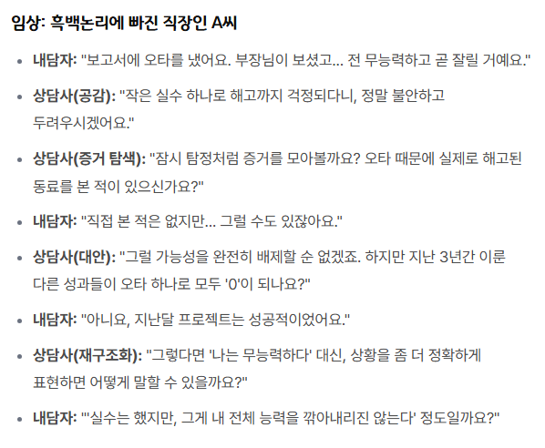

# 소크라테스 문답법

[*마음토스*](https://www.mindthos.com/blog/mastering-cbt-socratic-questioning-examples)

소크라테스식 대화법은 상담사가 답을 주는 대신 내담자 스스로 통찰에 이르도록 이끄는
***’유도된 발견’***의 원리에 기반한 대표적 인지행동치료 예시입니다.

**문제 제기, 가정·근거 검토, 반례 제시, 새로운 관점 도출**의 **4단계**로 전개되며
**CBT(인지행동치료)**는 이를 **명료화·증거·탐색·유용성 검토**라는 **임상 3단계 전략**으로 재구성합니다.

**개방형·근거 탐색·반례 가정·관점 확장**이라는 **4가지 질문 유형**을 상황에 맞게 활용하되,
**일방적 심문화와 정답 유도**, 위기 상황에서의 남용은 피해야합니다.

“왜”보다 **“무엇”**과 **“어떻게”**를 묻는 질문과 이후 **정밀한 복기**가 내담자의 인지적 유연성과 성장을 이끕니다.

소크라테스식 대화법은 고대 그리스의 **문답법(산파술)**에서 출발합니다.

### 소크라테스식 문답법

1. **문제 제기**: 내담자의 신념·주장을 하나의 명제로 꺼내 놓기
2. **가정·근거 검토**: 그 주장을 떠받치는 전제와 증거를 함께 살피기
3. **반례 제시**: 주장이 항상 성립하지는 않는 사례를 탐색하기
4. **새로운 관점 도출**: 검토 결과를 통합해 더 유연한 결론에 이르기

## 심문이 아닌 ‘발견’으로

핵심은 ‘답을 주는 것’이 아니라 **‘내담자 스스로 답을 찾도록 안내하는 것’
논리적 싸움이나 취조로 변질되면 안됨**

| **구분** | **오류 (심문/설득형)** | **소크라테스식 (발견/탐색형)** |
| --- | --- | --- |
| 질문의 의도 | 생각이 틀렸음을 증명 | 근거와 유용성을 함께 탐색 |
| 주된 질문 | WHY “왜 그렇게 생각하죠?” | +WHAT/HOW “어떤 증거가 뒷받침하나요?) |
| 상담사 태도 | 전문가적 권위, 교정 | 공동 연구자, 호기심 |
| 결과 | 방어기제·저항 | 인지적 유연성·통찰 |

“왜”라는 질문은 종종 비난처럼 들릴 수 있기에, “무엇이” “어떻게”로 바꿔 내담자가 자신의 사고 과정을 객관적으로 바라보게 하는 것이 중요하다.

### 예시

| **질문 유형** | **목적** | **예시 문장** |
| --- | --- | --- |
| 개방형 질문 | 생각을 넓게 펼치기 | “그때 어떤 생각이 스쳐 지나갔나요?” |
| 근거 탐색 질문 | 증거 확인 | “그 생각이 사실이라는 근거는 무엇인가요?” |
| 반례 가정 질문 | 예외 발견 | “그렇지 않았던 경험이 한 번이라도 있었나요?” |
| 관점 확장 질문 | 대안적 시각 | “가장 친한 친구라면 뭐라고 말해줄까요?” |

## 3단계 질문 전략

1. **명료화 및 정의** **(Clarification)**

내담자가 사용하는 모호한 단어의 의미를 구체화합니다.

”당신이 말하는 ‘완전한 실패’는 구체적으로 어떤 상태를 의미하나요?”
”이 상황에서 50%만 성공했다면, 그것도 실패에 포함되나요?”
2. **증거 탐색 및 대안** **(Evidence & Alternatives)**

자동적 사고를 뒷받침하는 증거와 반대되는 증거를 변호사처럼 검토해, 생각이 ‘사실’이 아닌 ‘가설’임을 깨닫게 합니다

”그 생각이 사실이라는 것을 뒷받침할 증거가 있다면 무엇인가요?”
”반대로 100% 사실은 아니라는 것을 보여준 경험이 있었나요?”
”가장 친한 친구가 같은 상황에 처했다면, 뭐라고 말해줄까요?”
3. **결과 및 유용성 검토(Implications & Utility)**

진위 여부를 떠나, 그 믿음이 내담자의 삶에 도움이 되는지를 묻는 기능적 접근입니다.

”그 생각을 계속 믿는 것이 당신의 우울감을 줄이는 데 도움이 되나요?”
”생각을 조금 더 유연하게 바꾼다면, 어떤 일이 일어날까요?”

## 사례

+간단한 상담

“친구가 답장을 안 하니 나를 싫어하는 게 분명해”
→ “다른 답장이 늦을 이유는 없을까?” (반례 가정)
     “반대 상황이라면 너는 어떻게 설명하고 싶어?” (관점 확장)

